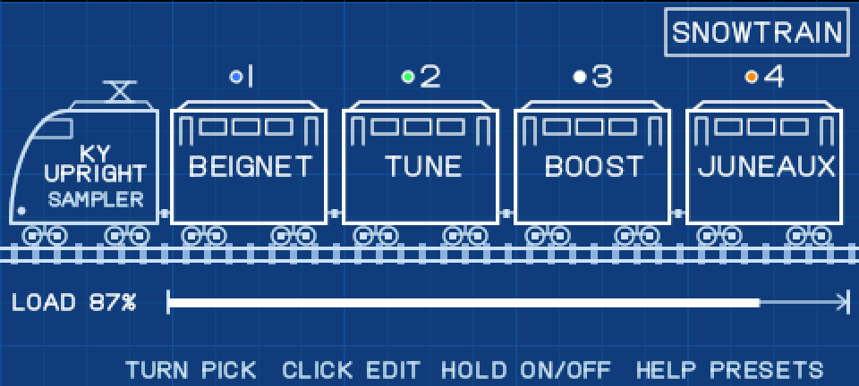
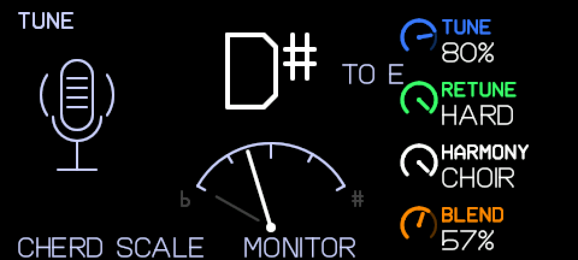
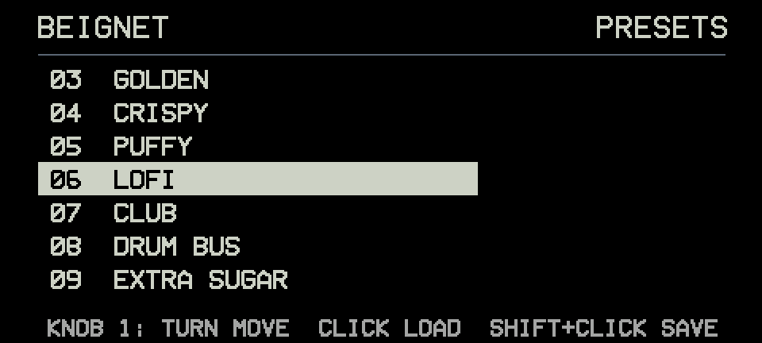
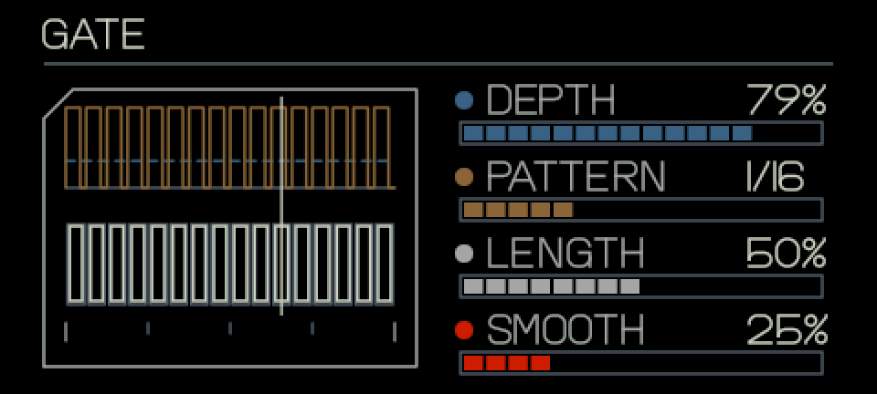
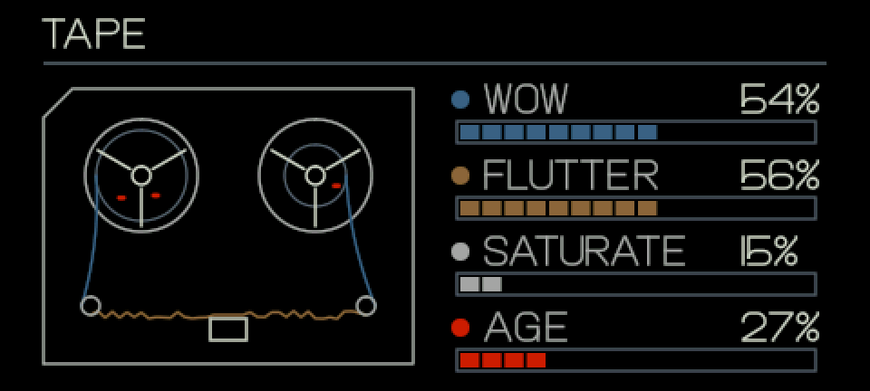
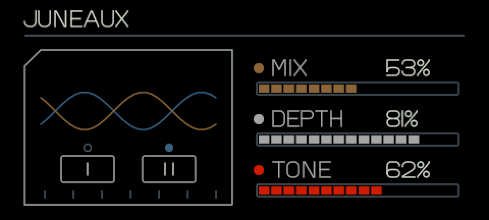
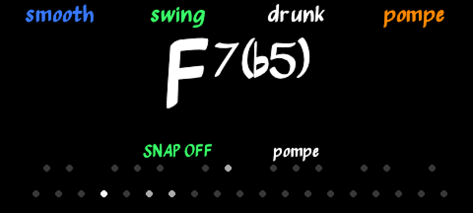
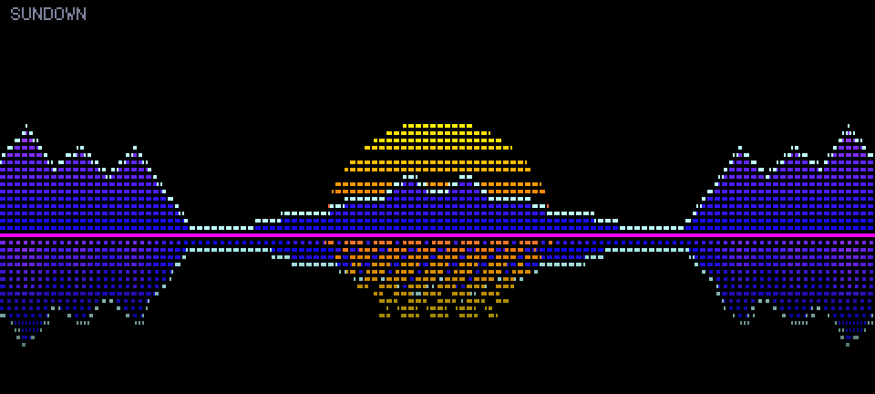
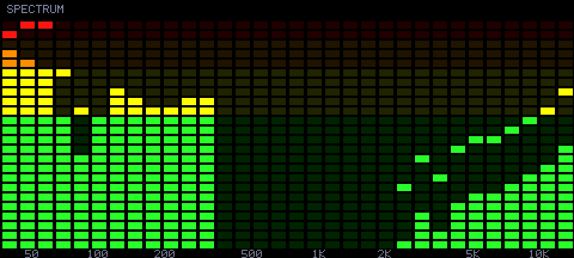

# field-packs releases

Packs for the **OP-1 Field** on **OS 1.7.3** (the +0 and +1 releases both work) with Faust's [open-field](https://github.com/LaP0573/open-field), by
hasis. This repository holds the released pack files only (no sources). Six releases:

## fx 1.3: three effect packs

| Pack | What it does | Version |
| --- | --- | --- |
| [snowtrain](packs/snowtrain/README.md) | A light fx train: on each synth and drum sound, TE's T3 effect plus three pack effects as wagons; trains on tape tracks too. Presets. A click on a pack effect's wagon opens its values page. | 20 |
| [wagons](packs/wagons/README.md) | Seven effects in TE's own effect lists: BOOST, GATE, FREEZE, TAPE, JUNEAUX, ROTARY (a rotary speaker cabinet) and BEIGNET (a mastering sweetener: glue, tone, width, loud, a -1 dBFS limiter; presets). | 18 |
| [TUNE](packs/tune/README.md) (`tune.pack`) | Pitch correction on the live input (shift + HELP) with harmonies, and a TUNE effect. | 29 |

Upgrading from fx 1.2: copy `wagons.pack` and delete `beignet.pack` (BEIGNET now lives in wagons; saved sounds and presets keep working).

GATE, FREEZE and TUNE follow CHERD's chord when CHERD is installed.

| snowtrain | |
| --- | --- |
|  |  |
|  | |

| BEIGNET (in wagons) | TUNE |
| --- | --- |
|  |  |
|  | |

| wagons | |
| --- | --- |
|  |  |
|  | |

Screens captured on an OP-1 Field.

## CHERD 57: the chord sequencer

[CHERD](packs/cherd/README.md) (`cherd.pack`, version 57; CHERD 37 was the release before): chords from one key, a
sequencer in the synth's sequencer list, with flavors, strum, comp, arp and a FEEL page. New since 37: **NEXT** (under
the chord's name, the likeliest next chords, by name, ranked on the key picture), fakebook spelling, and **LOCK** (HELP
held + a flavor key locks that flavor onto every chord). Chains are not in this release (coming in a later one). **[The CHERD manual](packs/cherd/MANUAL.md)**; a one-page
[quick start](docs/CHERD-quickstart.pdf). The chord font (Field Sans) is inside the pack: nothing else to copy.

| | |
| --- | --- |
|  |  |

## recstart 13: sound starts the recording

[recstart](packs/recstart/README.md) (`recstart.pack`, version 13): with REC held on a stopped tape, TE starts the take
on the first key; recstart starts it on the first **sound** over TE's input THRESHOLD too. For an MPC, a drum machine or
any gear on line in or USB: hold REC, start your gear, and the take begins with its first sound. While it waits,
WAITING: INPUT shows in the top right corner of the tape screen, with the level. Settings > PACKS > RECSTART: auto start
on / off, threshold TE or -60 to -24 dBFS. No files of its own; a one-page [quick start](docs/recstart-quickstart.pdf).

## engines 2: lilith, the clarinet and boarder, synth engines

Three engines in the unit's engine list (shift + T1), **native**: they render in the unit's own voices through
open-field's engine interface, so TE's T3 effect, snowtrain and fx train apply to them directly, as to TE's own engines.
TE's velocity sets lilith's loudness; TE's pitch bend and glide move the clarinet hole by hole. Saved sounds keep working.

| Pack | What it does | Version |
| --- | --- | --- |
| [lilith](packs/lilith/README.md) | A mono virtual-analog bass engine: two oscillators into a Moog-style ladder filter with its own decay envelope, an animated face, ten sounds. [Manual](packs/lilith/MANUAL.md), [quick start](docs/lilith-quickstart.pdf). | 16 |
| [clarinet](packs/clarinet/README.md) | A clarinet: a physical model of the reed and the bore, not samples, an animated face, five sounds. One voice; long notes breathe, slurs change holes. [Manual](packs/clarinet/MANUAL.md), [quick start](docs/clarinet-quickstart.pdf). | 16 |
| [boarder](packs/boarder/README.md) | An organ, six voices: tonewheels (nine drawbars, percussion, key click, scanner vibrato and chorus, a driven preamp) and two combo-organ modes; twenty sounds and an organist on T1. Made for the ROTARY wagon. [Manual](packs/boarder/MANUAL.md), [quick start](docs/boarder-quickstart.pdf). | 22 |

The engines sit at TE's own engine level; the clarinet's and boarder's sounds have a raised volume. Sounds an earlier
version wrote into `user/synth_presets/<engine>/` stay as they were: delete that folder before you restart to get these.
**synthbus is no longer needed:** if `synthbus.pack` is on your unit, delete it.

| lilith | clarinet | boarder |
| --- | --- | --- |
|  |  |  |

## vu 36: visualizers on the mixer

[vu](packs/vu/README.md) (`vu.pack`, version 36) paints the master mix (after the master effect) on TE's mixer levels
page. **HELP** on the levels page opens a picker of the looks installed (1st knob moves, click picks, HELP closes); a tap
of the mixer key (let go within 0.3 s) turns the picked look on / off (OFF = TE's own mixer). On a look the 1st to 4th knobs turn TE's master EQ
(LOW, MID, HIGH, ALL). With punch 3+ and **punch keys** on, the white keys hold punch's effects on a look (the effect's
name small at the top left; turning its knobs shows one thin line of values at the bottom). With markers 94+, shift +
a key on a look cues that marker as on the tape screen.

**Pick the one or two looks you like and copy just those plus vu.pack; the zip has all ten to choose from.** The core
looks are SUNDOWN, SPECTRUM, CLASSIC, LCD and VU; CONSOLE, BELLA, ANDY, GOOD TIMES and SCOPE are optional extras.

| | | |
| --- | --- | --- |
|  |  |  |
| SPECTRUM (core) | CLASSIC (core) | LCD (core) |
|  |  |  |
| VU (core) | CONSOLE (optional) | ANDY (optional) |

All ten looks, three moments each: [packs/vu/pictures/looks_vu34.png](packs/vu/pictures/looks_vu34.png); each look's README has its GIF.

| Pack | Looks | Version |
| --- | --- | --- |
| [vu](packs/vu/README.md) (needed) | none of its own: the analysis, HELP's picker, the tap, the EQ knobs, the settings | 36 |
| **core** | | |
| [vu_sundown](packs/vu_sundown/README.md) | SUNDOWN: a synthwave sunset over mirrored mountains made of the bands (in vu_spectrum until 5) | 1 |
| [vu_spectrum](packs/vu_spectrum/README.md) | SPECTRUM: an LED analyser | 6 |
| [vu_classic](packs/vu_classic/README.md) | CLASSIC: thin bars with peak caps, or the wave as dots / lines | 4 |
| [vu_lcd](packs/vu_lcd/README.md) | LCD: a backlit dot-matrix panel with the tape, the BPM and 30 bars | 5 |
| [vu_meter](packs/vu_meter/README.md) | VU: two needle meters with PEAK lamps | 4 |
| **optional** | | |
| [vu_console](packs/vu_console/README.md) (optional) | CONSOLE: a retro sci-fi computer panel: a rounded frame and colour blocks, pill bars, a radar sweep with blips, scrolling hex, readouts | 4 |
| [vu_bella](packs/vu_bella/README.md) (optional) | BELLA: MARY BELLE the cow dancing on a 90s car stereo's LED panel | 10 |
| [vu_andy](packs/vu_andy/README.md) (optional) | ANDY: an orange tabby in a red 26 jersey who does the Griddy, plops when it goes quiet and MEOWs (our cat, Andruella Robertson) | 8 |
| [vu_goodtimes](packs/vu_goodtimes/README.md) (optional) | GOOD TIMES: a feedback picture kicked by the beats | 3 |
| [vu_scope](packs/vu_scope/README.md) (optional) | SCOPE: the wave, a goniometer and a phase bar | 3 |

Settings under settings > packs > vu: **EQ knobs** (on) and **punch keys** (off; with punch 3 the white keys hold its
effects on a look). On / OFF and the picked look are kept in `user/pf/vu/look.txt` (every base). **look** (the picked look) and **classic** (CLASSIC's
style: bars / dots / lines) appear in settings on bases with option words (open-field PR #56, pending); on
other bases those two rows don't show, HELP's picker picks the look and CLASSIC draws bars.
The looks are vu 34's (the same files); upgrading from vu 34: copy the new `vu.pack` over the old one.
The tap does not clash with Faust's sidechain (shift + mixer).

## tape views 1: lanes, markers, PERFORM, punch-in effects, looks, MIDI tracks

Packs for the **tape screen**. Take the ones for what you want:

| You want | Copy |
| --- | --- |
| TE's tape screen with waveforms, a height zoom and tall lanes | `lanes.pack` |
| Markers: set, name, cue, jump, loop the parts of a song | `markers.pack` |
| + the PERFORM face (a set list, a song arranger) and punch-in effects | + `perform.pack`, `punch.pack` |
| + a look for the tape screen, the PERFORM face and the mixer | + `themes.pack` and **one** look (`theme_89mph.pack` or `theme_console.pack`) |
| MIDI tracks on the tape | `miditracks.pack` (its insert browser needs `seqbank.pack` 20, in the seq 20 release) |

| Pack | What it does | Version |
| --- | --- | --- |
| [lanes](packs/lanes/README.md) | Waveforms in TE's clip bars; HELP + 4th turn: 8 / 4 / 2 / 1 tracks; **tall lanes** (settings, off at first): tall lanes on TE's own tape screen, TE's deck small in the centre, the timecode top right (not with a theme on the tape screen; with markers its flags hang above the moved ruler). | 98 |
| [markers](packs/markers/README.md) | Up to 16 markers a tape: set, name, cue, jump, loop, move a section. Needs nothing else. | 96 |
| [perform](packs/perform/README.md) | The 4th knob's click: PERFORM, the markers as a set list; the song arranger and its EDIT. **Needs markers.** | 6 |
| [punch](packs/punch/README.md) | 14 punch-in effects held on the white keys on the PERFORM face. | 3 |
| [themes](packs/themes/README.md) | Draws the tape screen, the PERFORM face and the mixer in a look. **Needs a look.** | 11 |
| [theme_89mph](packs/theme_89mph/README.md) | The look 89MPH: a car head unit's segment readouts and dot-matrix lanes; the mixer too. Needs themes. | 5 |
| [theme_console](packs/theme_console/README.md) | The look CONSOLE: an elbow header and pill lanes. Needs themes. | 6 |
| [miditracks](packs/miditracks/README.md) | Any tape track can be a MIDI track: record notes, play them to the synth, the drum, MIDI out; PUNCH lanes. Needs nothing else. | 47 |

Every pack works alone except perform (needs markers) and a look (needs themes); each one that is there adds to the
others (flags and notes drawn in a look, effects on the face, PUNCH lanes, ...).

**Works with / without** (each pack loaded alone with the base, checked with the loader's simulation on Faust's stock
base 42 and on a base with #55 / #56, with and without 8 tracks):

| Pack | Needs | Without ... |
| --- | --- | --- |
| lanes | nothing | markers: no flags (lanes then does the time zoom, HELP + 2nd turn, itself); miditracks: no notes; 8 tracks: 4 lanes. Tall lanes stay off under a theme; with markers the flags hang above the moved ruler |
| markers | nothing | lanes / themes: flags in TE's own layout; perform: no song; punch: program changes go on to TE; 8 tracks: a 4-track tape (moves carry tracks 5-8 only with 8 tracks) |
| perform | **markers** (does not load without it) | themes: its own plain face; punch: no effects on the face |
| punch | nothing to load, but **perform or vu to play**: the keys work on perform's face (plain or in a look) or on a vu look with vu's **punch keys** on, not on TE's mixer page | perform and vu: only a PUNCH lane (miditracks) plays the effects; program changes count only while a face is up |
| themes | **one look** (theme_89mph or theme_console) | a look: TE's screens; lanes: no waveform, no height zoom; markers: no flags, sections or cue; perform: no face |
| theme_89mph, theme_console | **themes** (alone they load and do nothing) | |
| miditracks | nothing: **any** tape track can be a MIDI track (1-4 too; shift + 4th click) | 8 tracks: tracks 1-4 only (8 tracks adds 5-8; with our 8 tracks 13 / 14 they also follow the mixer's mutes, with Faust's 8 tracks they can't be muted); lanes: draws its notes itself; seqbank: no insert browser; punch: a PUNCH track is silent |

**On Faust's stock base (open-field 42), two things differ:**
- **No theme setting.** That base does not show settings with words, so the look is **on whenever it is installed**:
  the look packs you copy decide it. Install **one** look; to get TE's screen back, remove themes.pack.
- **Files kept per tape don't follow TE's tape copy and delete.** The base doesn't copy or remove lanes' waveforms
  (`user/pf/lanes/`; a copy's waveform fills in again as it plays) or `user/pf/miditracks/tape<N>.mtk`. miditracks catches a copy itself once the original tape has been loaded with it
  installed (a tape copied before that starts empty); a deleted tape's file stays until a new tape takes its number.

On a base with Faust's open-field pull requests #55 (files per tape) and #56 (options of words), offered to him and not
part of this release, settings > PACKS > themes > **theme** picks off / 89MPH / CONSOLE and the files follow copy and
delete. markers, perform and punch keep their data inside the tape: they follow copies on any base.

tape views 1 replaces the [lanes 87 pre-release](https://github.com/hasis/field-packs-releases/releases/tag/lanes-87-experimental):
copy its three files over the old ones.

## Install

1. **Requirements:** an OP-1 Field on **OS 1.7.3** (the +0 and +1 releases both work) with open-field installed by Faust's install page
   (it puts the loader and `base.pack` on the unit; open-field's `docs/guide.md`): open-field 0.24 (base 42) with
   loader N1 or N2, or an older base from 38. Nothing else. The packs are built with open-field's stock tools.
2. Download `fx-1.3.zip`, `cherd-57.zip`, `recstart-13.zip`, `engines-2.zip`, `vu-36.zip` and / or `tape-views-1.zip` from this repository's **Releases** and unzip it (check the files
   against `SHA256SUMS` if you like); each zip's own README.md says what is in it. Or take the `.pack` files from
   [`packs/`](packs) here.
3. Put the unit into disk mode and copy the `.pack` files into the unit's folder **`packs`** (in the bootloader's drive
   mode: `user/pk`). Take only the ones you want.
4. Leave disk mode and switch the unit off and on.

Or, once the packs are listed there, tick them on Faust's install page ([catalog.json](catalog.json) holds the entries).
**If something goes wrong:** hold **HELP** while you switch the unit on and no pack loads; then delete the file that
misbehaves. **snowtrain and fx train cannot run together:** take fx train off, or the loader keeps fx train and leaves
snowtrain out.

How to play them: **[the Player's Guide](docs/PLAYERS-GUIDE.md)** and each pack's README.

**Support:** this repository's Discussions (questions, sounds, presets) and Issues (bugs).

**Unofficial.** Not made, endorsed or supported by Teenage Engineering, and not affiliated with them ([NOTICE](NOTICE)).
**At your own risk:** open-field changes your unit's firmware (see its guide). **A pack is a program that can read and
write the files on your unit: take packs only from people you trust.**

## Licence

MIT, [LICENSE](LICENSE), 2026 hasis. Third-party parts keep their own licences: [THIRD-PARTY.md](THIRD-PARTY.md)
(Field Sans inside cherd.pack, OFL: [OFL.txt](OFL.txt); the clarinet's and boarder's published sources). Not affiliated with Moog Music: "Moog-style" names a filter style only. History: [CHANGELOG.md](CHANGELOG.md).
