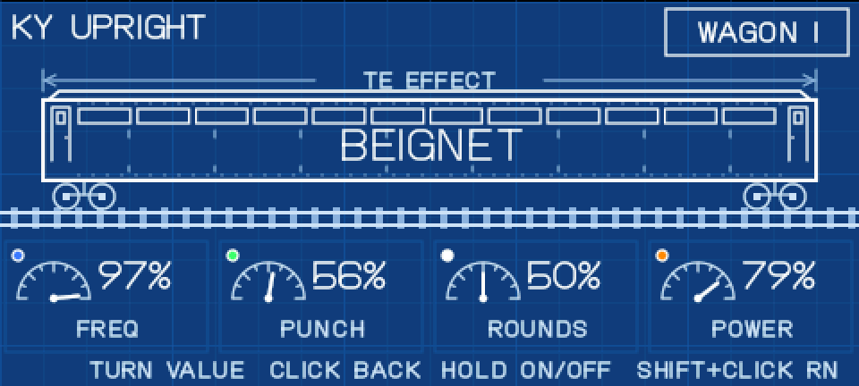
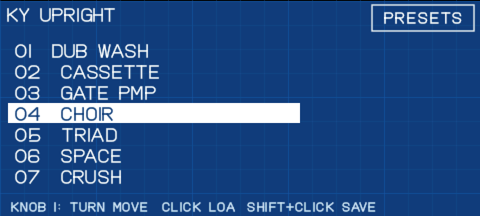
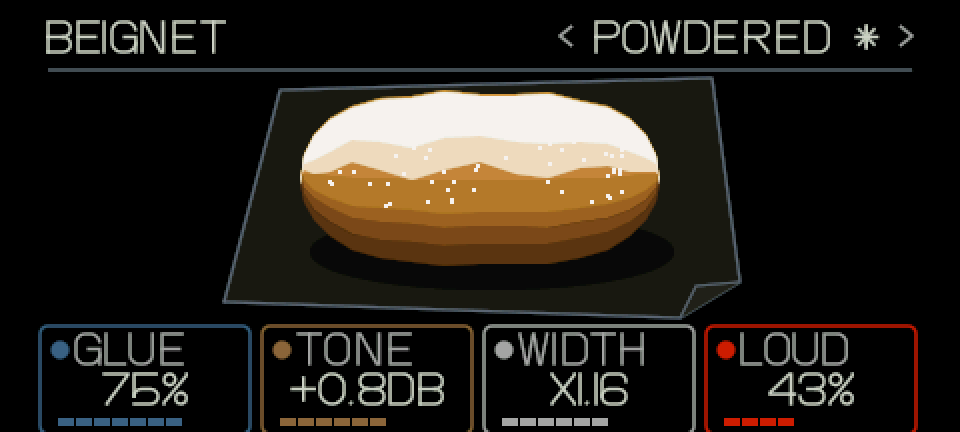
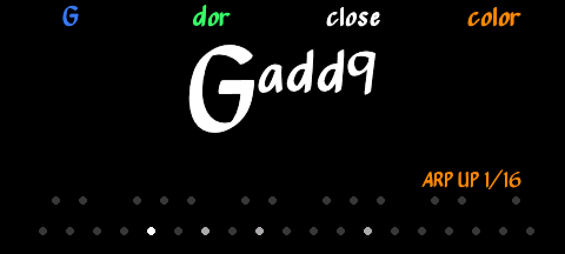

# field-packs releases

Packs for the **OP-1 Field** on **OS 1.7.3+0** with Faust's [open-field](https://github.com/LaP0573/open-field), by
hasis. This repository holds the released pack files only (no sources). Three releases:

## fx 1.2: four effect packs

| Pack | What it does | Version |
| --- | --- | --- |
| [snowtrain](packs/snowtrain/README.md) | A light fx train: on each synth and drum sound, TE's T3 effect plus three pack effects as wagons; trains on tape tracks too. Presets. A click on a pack effect's wagon opens its values page. | 20 |
| [wagons](packs/wagons/README.md) | Six effects in TE's own effect lists: BOOST, GATE, FREEZE, TAPE, JUNEAUX and ROTARY (a rotary speaker cabinet). | 17 |
| [beignet](packs/beignet/README.md) | BEIGNET, a mastering sweetener for the master slot: glue, tone, width, loud, a -1 dBFS limiter; presets. | 3 |
| [TUNE](packs/tune/README.md) (`tune.pack`) | Pitch correction on the live input (shift + HELP) with harmonies, and a TUNE effect. | 29 |

GATE, FREEZE and TUNE follow CHERD's chord when CHERD is installed.

| snowtrain | |
| --- | --- |
|  |  |
|  | |

| beignet | TUNE |
| --- | --- |
|  |  |
|  | |

| wagons | |
| --- | --- |
|  |  |
|  | |

Screens captured on an OP-1 Field.

## CHERD 57: the chord sequencer

[CHERD](packs/cherd/README.md) (`cherd.pack`, version 57; CHERD 37 was the release before): chords from one key, a
sequencer in the synth's sequencer list, with flavors, strum, comp, arp and a FEEL page. New since 37: **NEXT** (under
the chord's name, the likeliest next chords, by name, ranked on the key picture), fakebook spelling, and **LOCK** (HELP
held + a flavor key locks that flavor onto every chord). Chains are not in this release (coming in a later one). **[The CHERD manual](packs/cherd/MANUAL.md)**; a one-page
[quick start](docs/CHERD-quickstart.pdf). The chord font (Field Sans) is inside the pack: nothing else to copy.

| | |
| --- | --- |
|  |  |

## recstart 13: sound starts the recording

[recstart](packs/recstart/README.md) (`recstart.pack`, version 13): with REC held on a stopped tape, TE starts the take
on the first key; recstart starts it on the first **sound** over TE's input THRESHOLD too. For an MPC, a drum machine or
any gear on line in or USB: hold REC, start your gear, and the take begins with its first sound. While it waits,
WAITING: INPUT shows in the top right corner of the tape screen, with the level. Settings > PACKS > RECSTART: auto start
on / off, threshold TE or -60 to -24 dBFS. No files of its own; a one-page [quick start](docs/recstart-quickstart.pdf).

## Experimental: lanes 87 (pre-release)

Waveforms and a vertical zoom on the Field's own tape screen: `waveform` on in settings > PACKS > LANES, then hold
**HELP** and turn the **4th knob** for 8 / 4 / 2 / 1 lanes. Optional: `markers.pack` + `perform.pack` (attached too) add a
plain PERFORM page (parts list, cues, countdown) on the 4th click. Not yet: punch-ins and the 89MPH / CONSOLE looks. Download it from the
[lanes 87 pre-release](https://github.com/hasis/field-packs-releases/releases/tag/lanes-87-experimental), and please
[open an issue](https://github.com/hasis/field-packs-releases/issues/new) with anything odd: what you did, a photo of
the screen, your open-field version and other packs.

## Install

1. **Requirements:** an OP-1 Field on **OS 1.7.3+0** (not 1.7.3+1) with open-field installed by Faust's install page
   (it puts the loader and `base.pack` on the unit; open-field's `docs/guide.md`). Nothing else.
2. Download `fx-1.2.zip`, `cherd-57.zip` and / or `recstart-13.zip` from this repository's **Releases** and unzip it (check the files
   against `SHA256SUMS` if you like). Or take the `.pack` files from [`packs/`](packs) here.
3. Put the unit into disk mode and copy the `.pack` files into the unit's folder **`packs`** (in the bootloader's drive
   mode: `user/pk`). Take only the ones you want.
4. Leave disk mode and switch the unit off and on.

Or, once the packs are listed there, tick them on Faust's install page ([catalog.json](catalog.json) holds the entries).
**If something goes wrong:** hold **HELP** while you switch the unit on and no pack loads; then delete the file that
misbehaves. **snowtrain and fx train cannot run together:** take fx train off, or the loader keeps fx train and leaves
snowtrain out.

How to play them: **[the Player's Guide](docs/PLAYERS-GUIDE.md)** and each pack's README.

**Support:** this repository's Discussions (questions, sounds, presets) and Issues (bugs).

**Unofficial.** Not made, endorsed or supported by Teenage Engineering, and not affiliated with them ([NOTICE](NOTICE)).
**At your own risk:** open-field changes your unit's firmware (see its guide). **A pack is a program that can read and
write the files on your unit: take packs only from people you trust.**

## Licence

MIT, [LICENSE](LICENSE), 2026 hasis. Third-party parts keep their own licences: [THIRD-PARTY.md](THIRD-PARTY.md)
(Field Sans inside cherd.pack, OFL: [OFL.txt](OFL.txt)). History: [CHANGELOG.md](CHANGELOG.md).
