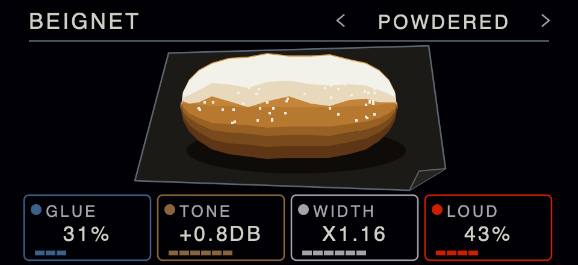
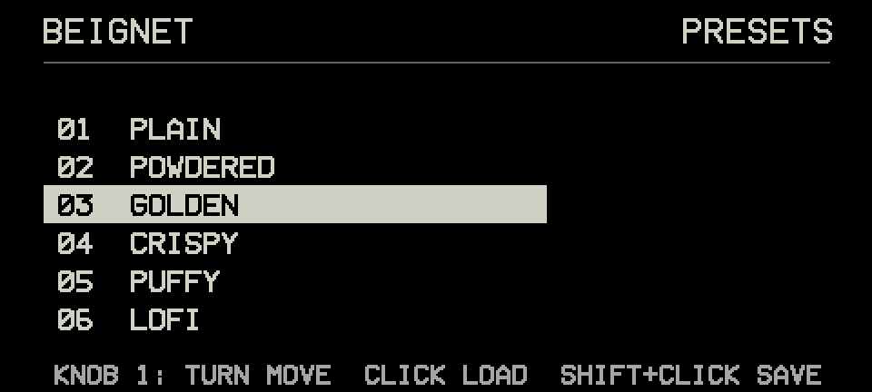
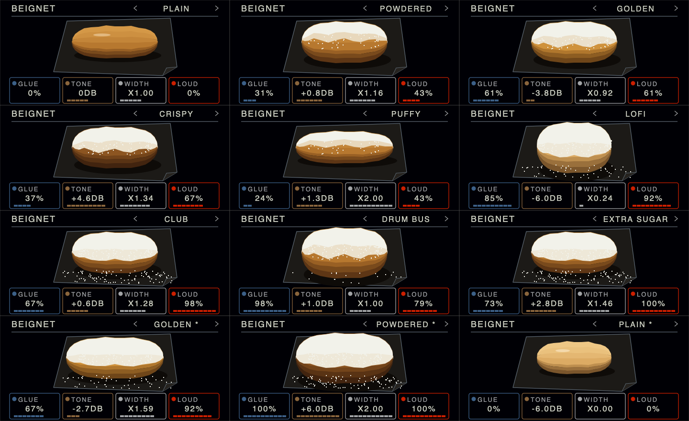

# BEIGNET (beignet.pack)

*Part of [field-packs](../../README.md). From the repository's root: `OPEN_FIELD=<open-field> make beignet` (or
`make check` for every pack); inside this folder its own `make pack` / `make check` work too.*

Part of the **fx 1** release (beignet 2). A mastering sweetener for the OP-1 Field, one effect for [open-field](https://github.com/LaP0573/open-field) 0.12
(OS 1.7.3): it makes the whole tape mix sound finished. Pick it in **TE's master effect slot** (mixer, T3). Like every
level-8 effect it is also in each synth and drum sound's T3 list and on fx train's / snowtrain's wagons. It is saved
with the master (or the sound) and the LFOs can move it. Its T3 page is a powdered beignet that changes with the knobs.

## The knobs

Knobs are named by position, 1st to 4th encoder from the left.

| Knob | 0 | middle | top | The page shows |
| --- | --- | --- | --- | --- |
| 1st **GLUE** | off (1:1) | 1.6:1, threshold -19 dBFS | 4:1, -28 dBFS | % |
| 2nd **TONE** | -6 dB tilt (dark) | flat | +6 dB tilt, +4 dB air at 10 kHz | tilt, `-6.0db` .. `+6.0db` |
| 3rd **WIDTH** | mono | as it came | sides x2, lows mono | side gain, `x0.00` .. `x2.00` |
| 4th **LOUD** | limiter only | +2.5 dB drive, 35 % saturation | +10 dB, 70 % saturation | % |

- **GLUE**: a bus compressor. It listens to the mix's mid, high-passed at 80 Hz so the kick doesn't pump it. Soft knee,
  attack 15 ms, a release that gets slower the longer it compresses. Makeup gain is 3/4 of what it takes off at
  -12 dBFS, at most +6 dB.
- **TONE**: a tilt around 1 kHz, with an air shelf at 10 kHz on the bright half.
- **WIDTH**: mid/side. The lows below about 200 Hz never get wider, and from x1.5 up they are mono.
- **LOUD**: drive into a soft saturator, then the limiter.
- **The limiter is always on**: -1 dBFS ceiling on samples and half-sample points, 1.45 ms lookahead (one block of
  latency). Nothing gets past -1 dBFS, whatever the knobs do.

## Presets

The same page as snowtrain's presets. On BEIGNET's page, **HELP** opens the list of 32 slots:

- **1st knob turn**: moves the cursor (the cursor's row is inverted).
- **1st knob click**: loads the slot. The four knobs jump to its values, which are saved with the master or the
  sound like a turn of each knob.
- **shift + 1st knob click**: saves the four knobs into the slot. A full slot only saves at the second shift + click
  (`AGAIN TO SAVE`). The new preset takes the name of the preset it came from, or `my NN`.
- **HELP** or **T3**: back to the face.

A box beside the cursor says what a click just did (`LOADED`, `SAVED`, `EMPTY`, `NOT SAVED`). With the list closed,
every knob is TE's again: GLUE keeps its fine turn with shift.

The presets are files, one a slot: `user/pf/beignet/01.txt` .. `32.txt`, in the folder `beignet` the computer sees in
disk mode. Each holds two lines: the name, then GLUE TONE WIDTH LOUD (0..32767). The nine factory presets are written
once into a folder with no preset file in it (`factory.txt` then says so). After that you can rename, edit or delete
them on the disk, and nothing of yours is written over. The face shows the name of the preset whose values the knobs
hold, else the one last loaded or saved there (or the nearest), with `*` once a knob differs from it.

The factory presets:

| Preset | GLUE | TONE | WIDTH | LOUD | What it does |
| --- | --- | --- | --- | --- | --- |
| **PLAIN** | 0 % | 0db | x1.00 | 0 % | only the -1 dBFS safety limiter |
| **POWDERED** (when picked) | 31 % | +0.8db | x1.16 | 43 % | the gentle one: a little glue, a touch of air and width, a few dB louder |
| **GOLDEN** | 61 % | -3.8db | x0.92 | 61 % | warm and dark: tilted down, glued, saturated, a touch narrower |
| **CRISPY** | 37 % | +4.6db | x1.34 | 67 % | bright: highs and air forward, wider, loud |
| **PUFFY** | 24 % | +1.3db | x2.00 | 43 % | very wide: sides x2, the lows mono |
| **LOFI** | 85 % | -6.0db | x0.24 | 92 % | dark, nearly mono, squashed and saturated |
| **CLUB** | 67 % | +0.6db | x1.28 | 98 % | loud and punchy: heavy drive, firm glue, lows narrowed |
| **DRUM BUS** | 98 % | +1.0db | x1.00 | 79 % | the full 4:1 glue with saturation, for a drums-only tape |
| **EXTRA SUGAR** | 73 % | +2.8db | x1.46 | 100 % | everything up: the loudest preset |

The factory set is `src/presets.json`.

## The faceplate

Open it as any T3 page and leave it with T3. One beignet on folded paper. Every knob changes its shape, so you can read
it without telling colours apart:

- 1st **GLUE**: puffier, taller
- 2nd **TONE**: the crust goes from pale to golden to dark fried
- 3rd **WIDTH**: wider
- 4th **LOUD**: more powdered sugar. A cap grows down the top, grains pile up, and from about 3/4 the sugar spills
  onto the paper

Each knob also has a box in its own colour along the bottom, with its name, its value in words and a 10-segment bar.

**On / off.** T3 switches BEIGNET on and off, as with TE's own effects. The base draws no notice over a page that stands
in for TE's, so BEIGNET draws its own: `FX OFF` or `FX ON` in the middle for a moment at the switch, and `OFF` beside
the title for as long as it's off.

The pictures are drawn on a Mac from the same picture file the unit uses (`make preview`). The texts are in a
stand-in font; the unit draws its own small letters.

## Install

1. open-field 0.12 on the unit (its install page puts the loader and `base.pack` on it).
2. Copy `beignet.pack` (from the fx 1 release zip, or built) into the folder `packs` the unit shows in disk mode (`user/pk` on its disk).
3. Leave disk mode and switch the unit off and on. On the mixer, open the master effect's list and pick `beignet`
   (sorted by name, before `cwo`).

Holding the help key while switching on starts the unit with no packs. Delete the file to remove the effect. A sound
or master saved with BEIGNET plays `punch`, switched off, on a unit without the pack.

### Needs

- An OP-1 Field on **OS 1.7.3** (+0 or +1) with open-field 0.12: `base.pack` level 10 (base 30 or later). Nothing else; it
  reads no firmware address.

