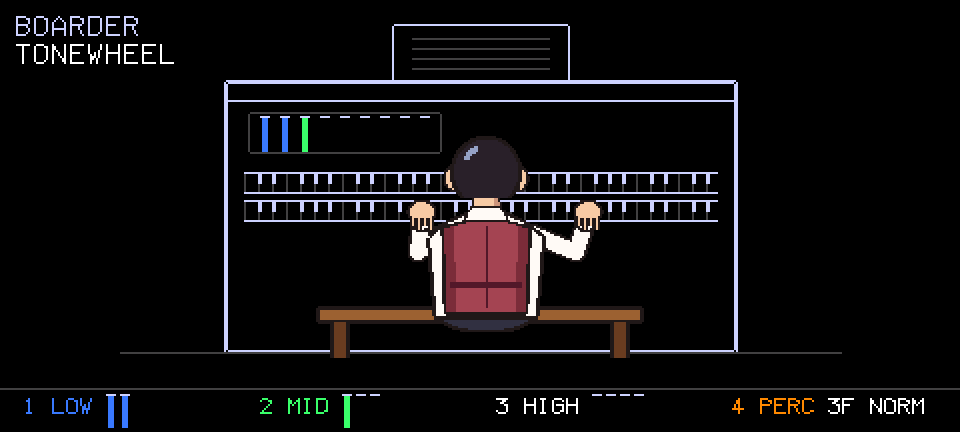

# boarder manual

**A tonewheel organ you play from the keys of the OP-1 Field.** boarder.pack 22, for OP-1 Field OS 1.7.3 (+0 or +1) with
Faust's [open-field](https://github.com/LaP0573/open-field) 0.12 or later.

boarder is a synth engine in TE's own engine list. It works like the electromechanical organs it is modelled on:
91 wheels turn on one shaft, and each one gives a pure tone. Each key picks nine of those wheels, one per drawbar, at
nine footages. Two keys that use the same wheel share it. Percussion, key click, a scanner vibrato and a preamp finish
the sound. The organ is mono and made to play into a rotary effect (the ROTARY wagon).

Knobs are named by position: the **1st knob** is the leftmost encoder, the **4th** the rightmost. **A + B** means hold
A, then press B.

**Contents:** 1 Quick start · 2 The face · 3 The knobs · 4 Playing · 5 The sounds · 6 With other packs ·
7 Install and remove · 8 Limits · 9 Reference card

## 1. Quick start

1. Copy `boarder.pack` into the unit's folder `packs`, then switch the unit off and on.
2. In synth mode press **shift + T1**: TE's engine list opens. Pick **boarder**.
3. Pick **jazz** from TE's sound list and play a chord, then a line with the keys detached: each new phrase starts
   with the percussion's ping.
4. Turn the **3rd knob** (HIGH) up for a brighter, whistling top. Turn the **1st knob** (LOW) down for less bass.
5. Put the ROTARY wagon after it for the spinning-speaker sound.

## 2. The face

*Host render: a held chord.*

**The organist.** A dapper 1920s gent in pixel art: slicked hair with a shine, a waistcoat over white shirt sleeves,
hunched eagerly over a two-manual console drawn in line art. You see him from behind. He plays what you play:

- **His hands** reach out by pitch: the left one for the lowest key sounding, the right one for the highest. A single
  note uses the hand on its side. Each new note dips the hand, and chords of three or more keys wiggle his fingers.
- **His head** nods at each new note. A held chord sways him.
- **Percussion** gives a finger stab: the hand jumps up at each single-trigger.
- **VIB on C3** and he hunches further in over the keys.
- **Silence:** he waits. Now and then he straightens his collar or turns a page on the music rack.
- **The console's drawbar strip** (left of his head) shows the registration as lengths. The 1' goes dim while
  percussion takes it.

**The strip at the bottom** shows the four knobs in order, each with its number and name: **1 LOW · 2 MID · 3 HIGH ·
4 PERC**.
- Beside LOW, MID and HIGH sit their drawbars, drawn as on the console: one small bar per drawbar, longer the further
  it is out (0 to 8). LOW has two bars, MID three, HIGH four.
- While you turn one of those knobs, its drawbars show as digits for about a second (**88**, **800**, **0000**), then
  as bars again.
- PERC shows its value in words: OFF, or 3 or 2 (3RD or 2ND), F or S (fast or slow), then NORM or SOFT (**3F NORM**,
  **2S SOFT**).

Hold shift and the strip shows **1 CLICK · 2 VIB · 3 DRIVE · 4 LEAK** (CLICK, DRIVE and LEAK as 0 to 99), with
SHIFT above it. Nothing depends on colour.

## 3. The knobs

| Knob | Name | What it does |
| --- | --- | --- |
| 1st | LOW | the bass drawbars: the 16' comes in first (00 to 80), then the 5 1/3' (to 88) |
| 2nd | MID | the 8' first (000 to 800), then the 2 2/3' (to 808), then the 4' (to 888) |
| 3rd | HIGH | the 1 3/5' first, then the 1 1/3', then the 1', then the 2' (0000 to 0800, 0880, 0888, 8888) |
| 4th | PERC | OFF, 3RD FAST, 2ND FAST, 3RD SLOW, 2ND SLOW (NORM), then the same four SOFT |
| shift + 1st | CLICK | key click: at 0 a key fades in; turned up, its nine contacts close one after the other and bounce |
| shift + 2nd | VIB | the scanner: OFF, vibrato V1 to V3, chorus C1 to C3 (chorus mixes the straight sound in) |
| shift + 3rd | DRIVE | the preamp: clean at 0, a growl in the middle, overdriven at the top |
| shift + 4th | LEAK / MODE | leakage over the first two thirds (a faint wheel four octaves away, as worn wiring does); then the combo modes COMBO 1 and COMBO 2 |

Each group knob walks a fixed path, and every step on the path is an exact registration. The classics are on the
paths: 888 000 000, 838 000 000, 008 080 800, 886 000 000, 800 000 888, 888 888 888. A pattern off the path cannot be
set: MID 860, for example, because 2 2/3' comes before 4'.

### Combo modes: COMBO 1 and COMBO 2

Turn **shift + the 4th knob** past its first two thirds (LEAK) and boarder becomes a transistor combo organ, of the
kind that played sixties garage and psych: **COMBO 1** (bright and buzzy) further on, **COMBO 2** (thin and piercing) at the
end. The face says the mode under the title, and the strip shows MODE.

- Every note is a divider oscillator, so the tuning is equal-tempered and there is no leakage, no percussion and no
  contact chatter.
- The nine drawbars still set the footages, with the same three groups on the 1st to 3rd knobs.
- **The 4th knob is TONE** in a combo mode: a soft, round flute at the left, the full reed at the right.
- VIB is the organ's vibrato (V1 to V3 deeper; C1 to C3 mixes the straight sound in). A gentle bass cut thins the
  bottom, as those organs did.
- Sounds: **fire**, **combo**, **sixties** (COMBO 1); **garage**, **surf** (COMBO 2).

## 4. Playing

- **Six voices.** TE's own voices are the keys, so MIDI, the sequencers and the arpeggiator all play it. One
  manual, one channel. For a bass line under a chord, play it in the same range or change the octave.
- **The key is a switch.** The organ sounds while a key is held and stops within about 6 ms of letting go, whatever
  TE's envelope says. TE's envelope only shapes the attack (pale swells in) and the held level; its release is
  ignored. The sounds use no decay, full sustain and the shortest release.
- **Percussion is single-trigger.** It sounds when you press a key while no other key is down. Play legato and the
  next note has none; lift every key and the next note pings again. Percussion takes the 1' drawbar away, and
  normal (not soft) percussion takes the other drawbars down a little.
- **Pitch bend does not bend.** A tonewheel cannot bend: each voice plays the nearest key.

## 5. The sounds

Twenty sounds, fifteen of them tonewheel, five combo (the Percussion column says the mode and TONE for those). Every registration sits on the knob paths (chapter 3), so turning a group knob from a sound and
back finds it again. onions takes the 2 2/3' with its 4' (the MID path brings 2 2/3' before 4').

| Sound | Drawbars | Percussion | Scanner | Character |
| --- | --- | --- | --- | --- |
| jazz | 888 000 000 | 3RD FAST | C3 | the jazz-trio sound |
| blues | 838 000 000 | off | C3 | darker, with the hollow 5 1/3' |
| flute | 008 080 800 | off | V3 | a soft flute with a wide vibrato |
| ballad | 886 000 000 | off | C3 | full and warm |
| whistle | 800 000 888 | off | off | bass and a whistling top, nothing between |
| full | 888 888 888 | off | C3 | every drawbar out, driven |
| rock | 888 000 888 | off | C3 | full bass and a screaming top, driven hard |
| pure | 008 000 000 | 3RD SLOW S | C1 | the 8' alone, a soft slow ping |
| fire | 008 880 888 | COMBO 1, TONE 85 | V2 | the bright, mixture-topped combo sound (a combo mode since boarder 16) |
| combo | 008 880 880 | COMBO 1, TONE 55 | V1 | the everyday combo organ |
| sixties | 008 880 000 | COMBO 1, TONE 25 | V3 | wobbly, mostly flute, a touch of drive |
| garage | 008 880 000 | COMBO 2, TONE 100 | off | thin and piercing, driven |
| surf | 008 880 800 | COMBO 2, TONE 80 | V3 | a wide vibrato |
| onions | 888 880 000 | 2ND FAST S | off | a mid-60s soul groove, dry |
| gospel | 888 888 888 | off | C3 | everything out, click and drive up: made for ROTARY fast |
| pale | 868 000 000 | off | C3 | a slow church ballad: mellow, a slow swell in |
| purple | 888 000 000 | off | C3 | a gritty rock lead, driven hard, some click |
| bubble | 008 000 000 | 2ND FAST | off | a reggae skank: short, a ping, dry |
| theatre | 888 880 880 | off | V3 | big and sweet, a wide vibrato |
| cool | 838 000 000 | 3RD FAST S | C1 | a light jazz comp |

## 6. With other packs

- **TE's T3 effect, snowtrain and fx train** work on the organ directly, as on TE's own engines.
- **ROTARY** (the wagons): the organ is mono and made for it.
- **CHERD** plays it like any engine: its chords sound on the organ's six voices.

## 7. Install and remove

Copy `boarder.pack` into the folder `packs` on the unit (in its disk mode;
the bootloader's drive mode: `user/pk`), then switch it off and on. At the first start the base writes its twenty
sounds into `user/synth_presets/boarder/`. To remove it, delete the file and restart; the sounds folder stays (delete
it in disk mode if you like), and sounds saved on boarder are silent without the pack. Hold HELP at power-on to start
with no packs.

## 8. Limits

- Plays on the unit.
- One manual of 61 keys (C2 to C7 in MIDI 36 to 96). Notes outside fold back into it by octaves.
- The organ's work is spread over the voice renders (since boarder 15): the host model puts the worst case (six keys
  struck together, every drawbar out, CLICK and LEAK full) at about 28k cycles a render, under the 40k it declares.
  The unit has not measured boarder 15 or later yet.

## 9. Reference card

| | page | shift |
| --- | --- | --- |
| 1st | LOW 16' 5 1/3' | CLICK |
| 2nd | MID 8' 2 2/3' 4' | VIB OFF V1-3 C1-3 |
| 3rd | HIGH 1 3/5' 1 1/3' 1' 2' | DRIVE |
| 4th | PERC | LEAK |
