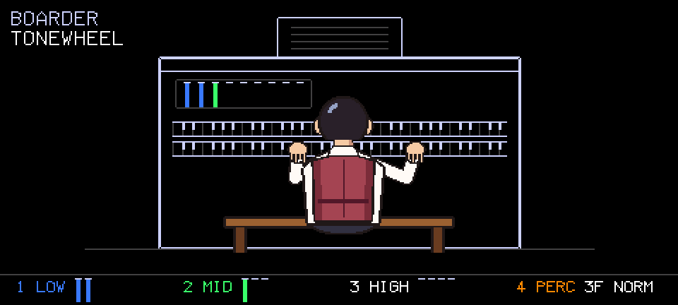
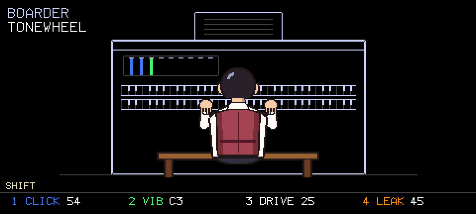
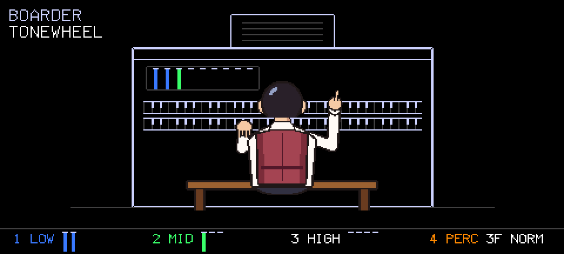
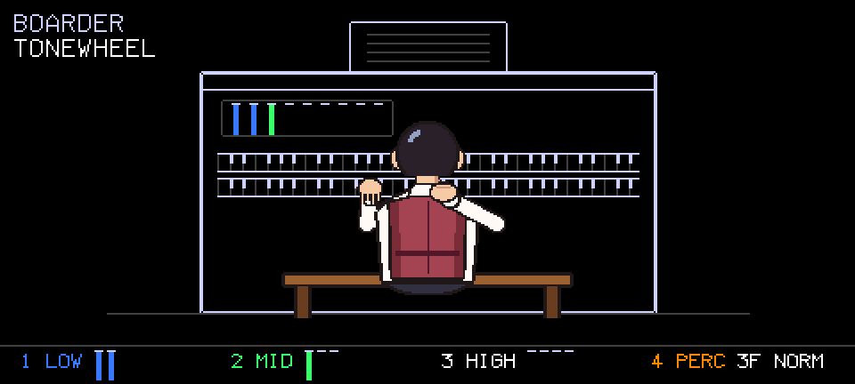

# boarder (boarder.pack)

**Quick start (one page):** [docs/boarder-quickstart.pdf](../../docs/boarder-quickstart.pdf).

**boarder: a tonewheel organ engine.** An organ in TE's engine list (shift + T1). It has 91 tonewheels on one
shaft, nine drawbars, percussion, key click, a scanner vibrato and chorus, and a preamp that drives. It plays six
voices from one manual on one MIDI channel. It is mono and made to play into a rotary effect. **[The boarder
manual](MANUAL.md)** has every gesture and the sounds in detail.

**Version 22, released in engines 2**, level 9, for OP-1 Field OS 1.7.3 (+0 or +1) with open-field 0.12 or later. **Native:** it
renders through Faust's level 9 engine interface alone: each of the unit's voices plays its own key of the organ (wheels
on one shaft, scanner and DRIVE per key), and the unit's envelope, mix, T3 effect and fx train (ROTARY) apply to it;
synthbus is no longer needed. Its sounds are at volume 32767 (the native engine sits at TE's engine level). Its 8'
matches lilith and FM on the unit.

## Screenshots

| | |
|---|---|
|  |  |
| **T1 face** (host render, tools/face_shots.cpp): the organist (pixel-art sprites) plays a held chord. The strip shows the four knobs: LOW, MID and HIGH as small drawbars, PERC in words. | **shift**: the strip shows CLICK, VIB, DRIVE, LEAK. |
|  |  |
| A high note with percussion: the finger stab. | Silence: he straightens his collar. |

## Gestures

| Gesture | Does |
| --- | --- |
| shift + T1 | TE's engine list: pick **boarder** |
| 1st knob | LOW: 16', then 5 1/3' (00 to 80 to 88) |
| 2nd knob | MID: 8', then 2 2/3', then 4' (000 to 800 to 808 to 888) |
| 3rd knob | HIGH: 1 3/5', then 1 1/3', then 1', then 2' (0000 to 0800 to 0880 to 0888 to 8888) |
| 4th knob | PERC: OFF, 3RD FAST, 2ND FAST, 3RD SLOW, 2ND SLOW, then the same four soft (the strip: `3F NORM` ... `2S SOFT`) |
| shift + 1st knob | CLICK: key click (contacts that close one by one and bounce) |
| shift + 2nd knob | VIB: OFF, V1, V2, V3, C1, C2, C3 |
| shift + 3rd knob | DRIVE: the preamp, clean to driven |
| shift + 4th knob | LEAK (first two thirds), then MODE: COMBO 1, COMBO 2 (combo organs; the 4th knob is then TONE, flute to reed) |

**Sounds (20):** ballad, blues, bubble, cool, flute, full, gospel, jazz, onions, pale, pure, purple, rock, theatre,
whistle (tonewheel); combo, fire, garage, sixties, surf (combo modes). Knobs are the 1st to 4th encoder from the left.

## Needs and works with

- open-field 0.12 (base 30 or later), OS 1.7.3 (+0 or +1).
- TE's T3 effect, snowtrain and fx train work on it directly; no synthbus.
- Made to go into a rotary effect: the ROTARY wagon.

## Files on the unit

None of its own. Its twenty sounds go into `user/synth_presets/boarder/`.

## Install and remove

With Faust's install page (its packs section), or by hand: unit in disk mode, copy `boarder.pack` into the folder `packs` (bootloader drive mode: `user/pk`), leave disk mode, switch the unit off and on. To remove
it, delete `boarder.pack` from the same folder and restart. Sounds saved on boarder need the pack to sound.
**Holding HELP while switching on starts with no packs.**

