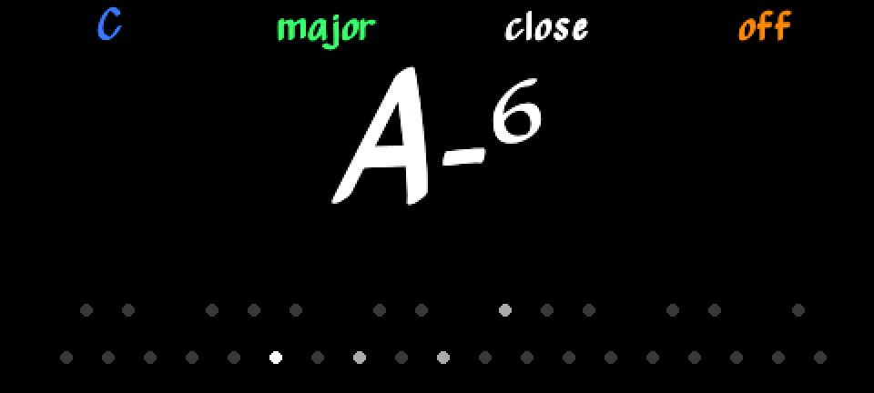

# cherd.pack

**CHERD: chords from one key.** A chord sequencer in the synth's sequencer list. With CHERD on, every key of the right octave plays a full chord
from the key and scale you set; the left octave picks the chord's flavor. Strum, comp, arp and a FEEL page (voice
leading, swing, humanize, comp pattern). Chord names in fakebook style (Field Sans, from Petaluma Script).

Version 37, for OS 1.7.3+0 with open-field 0.12. Released on its own as **CHERD 37** (`cherd-37.zip`). The built file:
[`dist/cherd.pack`](../cherd.pack). **The manual: [MANUAL.md](MANUAL.md)** (chords, Alt, Spice, flows, scales, strum,
comp, arp, the screen, settings).

## Screenshots

Renders of the page by its own drawing code (`CHERD_DUMP=<folder> python3 -I packs/cherd/pack012_test.py <open-field>`).

| | |
|---|---|
|  |  |
| **Page** (render): key, scale, spread, flow on the four knobs; the chord in Field Sans; the keys it plays. | **FEEL page** (render, 1st click): smooth, swing, human, comp pattern; SNAP under the 2nd knob. |
|  |  |
| **ARP page** (render, shift + 4th click latches it): mode, rate, gate, octaves. |  |

## Gestures

**Turn it on:** synth mode, shift + the sequencer key opens the sequencer list; CHERD is the eighth entry. Switching
the sequencer off keeps CHERD's page.

| Gesture | Does |
| --- | --- |
| left octave keys (F..E) | chord flavors, silent: F add6, F# dim, G sus2, G# minor, A sus4, A# major, B add9, C 9th, C# ALT, D 7th, D# dom7, E Spice. One quality (the latest held), extensions add up |
| right octave keys | roots: each key plays its chord |
| REC held | the flavor keys go to CHERD only and do not start the tape; only a root starts it |
| 1st..4th turn | Key (circle of fifths), Scale (off, major, minor, the modes, harmonic, melodic and 25 more), Spread (close, open, wide, bass, lead), Flow (off, color, jazz, pop, soul, gospel, bossa, ambient, blues, rock, monk, django) |
| 1st click | FEEL page on / off: Smooth, Swing, Human, comp pattern on the four knobs |
| 2nd click | strum: off, up, down, alt (on FEEL: the SNAP grid OFF, 1/16, 1/8, 1/4, 1/32, 1/8T, 1/16T) |
| 3rd click | comp on / off |
| 4th click | arp on / off |
| shift held | ARP page: mode, rate, gate, octaves; shift + 4th click keeps it open (again: lets it go) |
| HELP | one step back: the kept ARP page, then FEEL; on the main page HELP is TE's |

A flavor held when you strike a root stays with that chord until you let go of the root; one pressed after the strike
lasts only while held (tap sus4, let go to resolve). The octave arrows work over a held chord.
The full manual: [MANUAL.md](MANUAL.md). Quick start (one page): [docs/CHERD-quickstart.pdf](../../docs/CHERD-quickstart.pdf).

Knobs are the 1st to 4th encoder from the left; "A + B" means hold A, then press B. The full guide: [docs/PLAYERS-GUIDE.md](../../docs/PLAYERS-GUIDE.md).

## Needs and works with

- Needs: base.pack (level 7: the settings that follow the tape). Nothing else.
- Works with (optional, none needed): snap (FEEL's SNAP then edits snap's per-tape setting; without it CHERD keeps its own SNAP). CHERD offers `op1f_cherd_pcs` (its scale and sounding chord): wagons' GATE / FREEZE and TUNE (tune.pack) follow it.

## Files on the unit

- Settings follow the tape (cherd 34+: kept in the tape's own file); `user/pf/cherd/cherd.bin` holds the last ones
  changed, what a new tape and the start take (key, scale, flow, smooth shared; spread, strum, comp, arp, feel per
  synth slot).
- The chord font (Field Sans, a Modified Version of Petaluma Script (c) 2018 Steinberg Media Technologies GmbH, SIL Open
  Font License 1.1) is inside the pack: nothing to copy.
  Upgrading from cherd 36 or older: `user/pf/cherd/field_sans.runs` (or `petaluma.runs`) is no longer read and can go.

## Install

With the install page of open-field (its packs section), or by hand: unit in disk mode, copy `cherd.pack` into the folder `packs` (drive mode: `user/pk`), leave disk mode, switch the unit off and on. **Holding HELP while switching on starts with no packs.**
