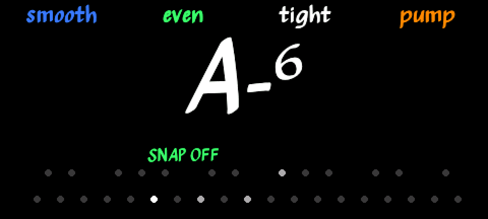
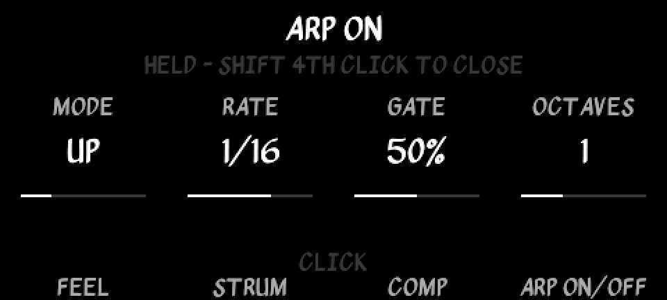
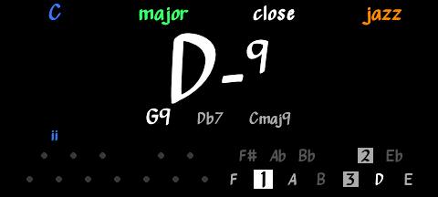

# cherd.pack

**CHERD: chords from one key.** A chord sequencer in the synth's sequencer list. With CHERD on, every key of the right octave plays a full chord
from the key and scale you set; the left octave picks the chord's flavor. Strum, comp, arp and a FEEL page (voice
leading, swing, humanize, comp pattern). Chord names in fakebook style (Field Sans, from Petaluma Script).

Version 57, for OS 1.7.3 (+0 or +1) with open-field 0.12. Released on its own as **CHERD 57** (`cherd-57.zip`); the release
before was CHERD 37. The built file: [`packs/cherd.pack`](../cherd.pack). Chains are not in this release (coming in a
later one): HELP held + a click or the 2nd..4th knob does nothing, HELP + a root plays its chord. **The manual:
[MANUAL.md](MANUAL.md)** (chords, Alt, Spice, flows, scales, strum, comp, arp, the screen, settings).

**Tip, recording:** REC jumps to the tape screen; tap the sequencer key to come back to CHERD's page: TE keeps recording, and NEXT stays in view.

## Spelling

**Spelling** (cherd 48, rebuilt in 49). Names only: the notes are the same.

- **One name per Key.** A Key keeps its letter whatever the Scale: C Db D Eb E F F# G Ab A Bb B for scales with a major third, the same but **C# and G#** for scales with a minor third. G# minor stays G# under the harmonic and melodic minor (with **F##**), Db stays Db under the harmonic major (with Bbb), B lydian is B, F altered is F.
- **Every scale note has its own letter**, double sharps and flats included (G# harmonic minor: G# A# B C# D# E F##). Pentatonic, blues and the Japanese scales are spelled from the seven-note scale that holds them (C# minor pentatonic: C# E F# G# B; F# blues: F# A B C C# E, the blue note the flat five). The altered scale is spelled by what its notes do over the dominant: 1 b9 #9 3 #11 b13 b7 (C Db D# E F# Ab Bb: the third is E, never Fb); whole tone is all sharps (C D E F# G# A#).
- **Chord roots outside the scale by their job**, as a fakebook writes them: borrowed bII bIII bVI bVII flat (Bb Ab Eb Db in C; **Cb and Fb** in Ab major), the tritone substitute flat (Db7 in C), a diminished leading-tone chord sharp (C#o in C, **B#o** in C# minor, **E#o** in F# minor, F##o in G# minor), but flat when it comes down a semitone (Em7 Ebo7 Dm7). The raised 3rd, 6th and 7th of a minor key take their own letter: a sharp, a natural in a flat key (E in F minor), a double sharp in G# minor.
- **The fallback:** a borrowed chord that would need a double flat takes the plain letter instead (bVI in Db major is A, not Bbb; bII in Ab major is A, not Bbb). A diminished leading-tone chord keeps its double sharp (F##o to G#m in B major).
- **A chord's notes from its root's letter:** the third, fifth and seventh on their own letters (D#7 in G# minor: D# F## A# C#; Fb in Ab major: Fb Ab Cb), b9 and #9 (never a b10), #11 beside the fifth and b5 without it, a 6 beside a seventh is a 13. The key picture's letters follow all of it, on white keys too (B# on the C key); a key outside the scale and the chord shows its plain letter, or the Key's signature on a black key.
- Alterations in fakebook terms, in parentheses: 7(b9) 7(#9) 7(#11) 7(#5), 7(b5) only where the fifth is gone, 7alt for a dominant with two or more altered notes and no natural fifth; - minor, the triangle maj7, ø the half-diminished (m7b5), o diminished.
- **The numeral** keeps the 7 on every dominant (I7 IV7 V7, bVI7, bII7), names secondary dominants (V/ii for A7 in C), tells ø7 from o7 and o, and marks an augmented chord with +.

## Theory (cherd 49)

An audit of CHERD's harmony (2026-11-25) found chords that lost notes or had the wrong function; cherd 49 fixes each one, and a host test walks every combination.

- **Every held flavor key sounds.** The notes are the union of what the keys ask and the name says exactly those notes: sus2 + 7th is C7sus2, sus4 + 9th C9sus4, sus4 + 7th + add6 C13sus4, minor + add9 + add6 C-6/9, a 7th + add6 a 13 (C13, Cmaj13, C-13), dim + 9th the m9b5, dim + add9 Co(add9). 58 chord names (were 40).
- **Deliberately left out, and only these:** Spice's fifth where it plays the 13 or 11; the ninth over Sus2 (it is the second itself); the 9th key's ninth where the scale's is a flat or sharp nine (no quality held); add6 over an augmented triad; under Alt, the natural fifth of a chord with both ninths (a 7alt has none) and, with both ninths and the sharp five too, the flat five / sharp eleven (a chord is five notes above its root); Alt + Spice is the full altered chord whatever else is held.
- **Spice is never thinner than the 7th.** Where the scale's ninth is not natural it takes the tension the chord does have: the 7(b9) or 7(#9) on a dominant, the maj7(#11) on harmonic minor's bVI and Phrygian dominant's bII (were three notes).
- **The seventh is the seventh:** the bebop dominant's and the half-whole scale's tonic is C7 (was C6); the bebop scales play their mode's chords (bebop dorian's tonic is minor); the altered scale's tonic is the altered dominant (C+ alone, C7(#5) with the 7th, C7alt with the 9th, Spice or jazz; was Cm7b5).
- **add6 is the major sixth on every degree** (Am6 and Em6 in C major, Cm6 in C minor, the diminished seventh on a diminished triad).
- **Sus2 and Sus4 are fixed intervals** (1 2 5 and 1 4 5 on any root), as Major, Minor and Dim are: they no longer swap for each other or turn into a diminished triad, and leave the key where its own second or fourth is another note (Esus2 in C major has F#). A genre's own suspensions (ambient, gospel) still stay in the key.
- **NEXT follows the chord's quality:** a secondary dominant goes to its target first (A7 to Dm, B7 to Em, D7 to G, C7 to F), a tritone substitute down a semitone (Db7 to C, Ab7 to G), the Neapolitan bII to V, a diminished leading-tone chord up a half step (G#o to Am), a passing one that came down goes on down (Em7 Ebo7 Dm7).

## Screenshots

Renders of the page by its own drawing code (`CHERD_DUMP=<folder> python3 -I packs/cherd/pack012_test.py <open-field>`).

| | |
|---|---|
|  |  |
| **Page** (render): key, scale, spread, flow on the four knobs; the chord in Field Sans; at the bottom the Field's 24 keys, dot for key (cherd 46): left octave the flavors held (dots), right octave the roots as their note names (cherd 47), the chord's notes lit, its root brightest. | **FEEL page** (render, 1st click): smooth, swing, human, comp pattern; SNAP under the 2nd knob. |
|  |  |
| **ARP page** (render, shift + 4th click latches it): mode, rate, gate, octaves. | **NEXT** (render, cherd 47): jazz after Dm9: the line under the name reads G9, then Db7 (the tritone substitute), then Cmaj9; boxes 1 2 3 on the keys G, Db and C; ii under the 1st knob. |

## Gestures

**Turn it on:** synth mode, shift + the sequencer key opens the sequencer list; CHERD is the eighth entry. Switching
the sequencer off keeps CHERD's page.

| Gesture | Does |
| --- | --- |
| left octave keys (F..E) | chord flavors, silent: F add6, F# dim, G sus2, G# minor, A sus4, A# major, B add9, C 9th, C# ALT, D 7th, D# dom7, E Spice. One quality (the latest held), extensions add up |
| right octave keys | roots: each key plays its chord. After a chord, **NEXT** names up to three likely next chords in a line under the chord's name, the likeliest first (large and white), the other two smaller and grey; each is the chord that key plays now (flavors held included), and its first letter is the key to press. On the key picture (the Field's keyboard, F to E twice; the right octave's keys show their note names) the same keys carry a box with 1 2 3: press the key with the big white 1. Before the first chord it shows the key's own chord; with the sequencer off, nothing. They follow the key's harmony (V goes home, ii to V, the deceptive vi) and the Flow (jazz: round the circle, the tritone substitute after ii; pop I V vi IV; gospel IV I; blues V IV I; rock I bVII IV; django the Andalusian run). A hint, never a rule (cherd 43; the line, cherd 45). Off: settings > PACKS > cherd > hints (cherd 46) |
| REC held | the flavor keys go to CHERD only and do not start the tape; only a root starts it. |
| 1st..4th turn | Key (circle of fifths), Scale (off, major, minor, the modes, harmonic, melodic and 25 more), Spread (close, open, wide, bass, lead), Flow (off, color, jazz, pop, soul, gospel, bossa, ambient, blues, rock, monk, django) |
| 1st click | FEEL page on / off: Smooth, Swing, Human, comp pattern on the four knobs |
| 2nd click | strum: off, up, down, alt (on FEEL: the SNAP grid OFF, 1/16, 1/8, 1/4, 1/32, 1/8T, 1/16T) |
| 3rd click | comp on / off |
| settings > PACKS > cherd > hints | on (default) / off: off hides NEXT's line and boxes, the note names (the right octave back to dots) and the chord's numeral under the 1st knob; kept by the base (base 34+; an older base: always on) (cherd 46) |
| 4th click | arp on / off |
| shift held | ARP page: mode, rate, gate, octaves; shift + 4th click keeps it open (again: lets it go) |
| HELP (let go, no key under it) | one step back: the kept ARP page, then FEEL; on the main page nothing. On CHERD's page HELP is CHERD's alone (cherd 54): TE shows no help on a sequencer's screen |
| HELP held + a left key | **LOCK** (cherd 50): that flavor stays on every chord as if held, until HELP + the key again. Any flavor; one quality (a held quality wins over it), extensions add up. A large white dot on its key, LOCK SPICE flashed on the top line for a moment (cherd 57; it used to sit under the left octave), and with Spice locked its colours ripple as while held (cherd 52); saved with the tape; with REC held it never starts the tape |

A flavor held when you strike a root stays with that chord until you let go of the root; one pressed after the strike
lasts only while held (tap sus4, let go to resolve). The octave arrows work over a held chord; for a second the page shows OCT +1 (or OCT 0, OCT -2) under the 4th knob (cherd 40).
Under the 1st knob the page names the chord's place in the key (ii, V, bVII; cherd 43). In jazz, the root a semitone above the tonic played after the two is the tritone substitute, a dominant seventh (Dm7 Db7 C; cherd 43; from anywhere else it stays the passing diminished seventh).
The full manual: [MANUAL.md](MANUAL.md). Quick start (one page): [docs/CHERD-quickstart.pdf](../../docs/CHERD-quickstart.pdf).

Knobs are the 1st to 4th encoder from the left; "A + B" means hold A, then press B. The full guide: [docs/PLAYERS-GUIDE.md](../../docs/PLAYERS-GUIDE.md).

## Needs and works with

- Needs: base.pack (level 7: the settings that follow the tape). Nothing else.
- Works with (optional, none needed): snap (FEEL's SNAP then edits snap's per-tape setting; without it CHERD keeps its own SNAP). CHERD offers `op1f_cherd_pcs` (its scale and sounding chord): wagons' GATE / FREEZE and TUNE (tune.pack) follow it.

## Files on the unit

- Settings follow the tape (cherd 34+: kept in the tape's own file); `user/pf/cherd/cherd.bin` holds the last ones
  changed, what a new tape and the start take (key, scale, flow, smooth shared; spread, strum, comp, arp, feel per
  synth slot).
- The chord font (Field Sans, a Modified Version of Petaluma Script (c) 2018 Steinberg Media Technologies GmbH, SIL Open
  Font License 1.1) is inside the pack: nothing to copy.
  Upgrading from cherd 36 or older: `user/pf/cherd/field_sans.runs` (or `petaluma.runs`) is no longer read and can go.

## Install

With the install page of open-field (its packs section), or by hand: unit in disk mode, copy `cherd.pack` into the folder `packs` (drive mode: `user/pk`), leave disk mode, switch the unit off and on. **Holding HELP while switching on starts with no packs.**
