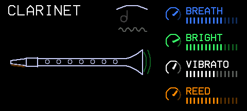

# clarinet manual

**A clarinet you play from the keys of the OP-1 Field.** clarinet.pack 16, for OP-1 Field OS 1.7.3+0 with Faust's
[open-field](https://github.com/LaP0573/open-field) 0.12 or later.

The clarinet is a synth engine in TE's own engine list. Its sound is not sampled: it is worked out sample by sample from
a model of the instrument, a reed that beats against the mouthpiece, the air squeezed through the gap, and a tube that
sends the pressure wave back to the reed. You set how hard you blow, how bright the tube is and how the lips hold the
reed, and the model does the rest. It is tuned for melody: swing, ballads, klezmer, New Orleans.

Knobs are named by position: the **1st knob** is the leftmost encoder, the **4th** the rightmost. **A + B** means hold
A, then press B.

**Contents:** 1 Quick start · 2 The face · 3 The knobs · 4 Playing · 5 The five sounds · 6 With other packs ·
7 Install and remove · 8 Limits · 9 Where the sound comes from · 10 Reference card

## 1. Quick start

1. Copy `clarinet.pack` into the unit's folder `packs` (chapter 7) and switch the unit off and on.
2. In synth mode press **shift + T1**: TE's engine list opens. Pick **clarinet**.
3. Pick a sound from TE's sound list: **swing** is the middle of every knob, a good start.
4. Play a phrase. Hold a note: it swells, then the vibrato grows into it.
5. Play a run with the keys overlapping: the notes slur, the way a player lifts a finger. Play them detached: each note
   is tongued, with a small scoop up into it.
6. Turn the **1st knob** (BREATH) up for a louder, buzzier tone, down for a soft, woody one.

## 2. The face

*Off the unit (zprobe screenshot).*

- **The clarinet** on the left. While a note sounds, air dots blow into the mouthpiece (more with BREATH, scattered
  with NOISE), the tone holes close for the note you play, and sound arcs leave the bell (wider with BRIGHT).
- **The reed** under the mouthpiece is drawn longer and thicker as REED goes up.
- **The note name** at the top, with a wavy line under it that moves with the vibrato, and an arc over it while
  LEGATO is on (SLUR).
- **The four knobs** on the right, each with its name and a row of ticks. Hold shift and they show the second four.

## 3. The knobs

| Knob | Turn | Hold shift and turn |
| --- | --- | --- |
| 1st | **BREATH**: how hard you blow. Low: soft and woody. High: loud, bright and buzzing. Even fully down, and at the softest velocity, the note still speaks. | **NOISE**: the air: breath noise and turbulence. Fully down there is none at all; it grows slowly at first, breathy at the top. It fades with each note, so nothing hisses between notes. |
| 2nd | **BRIGHT**: dark to bright. Up, the tube loses less of its highs and the low register opens up; down, the low notes go round and dark the way a real clarinet's do. The top register stays open either way. | **RATE**: vibrato speed, about 4.6 to 6.4 times a second. |
| 3rd | **VIBRATO**: depth of the vibrato. It never starts at the attack: notes under about a third of a second stay straight, and it grows over the next second. Subtle in the lower half, a wide singing vibrato (about a quarter tone either way) at the top. | **SCOOP**: how far a tongued note bends up into pitch from below. Lower half: none to half a semitone, quick. Upper half: a lip scoop of up to 3 semitones over about a third of a second, on the first note of a phrase; notes tongued inside a phrase keep the half semitone. |
| 4th | **REED**: the embouchure. Down: a loose reed, softer and rounder. Up: a firm reed, edgier and higher in its buzz. | **LEGATO**: OFF, every note tongued; SLUR (the upper half), overlapping notes slur. |

The knobs act straight on the model: TE's LFO does not move them.

## 4. Playing

- **One voice.** The clarinet plays one note at a time. The last key you press wins; let it go while an earlier key is
  still held and the clarinet goes back to that one, as a real player would.
- **Tongued and slurred notes.** A note started with no other key down is tongued: a short push of breath, and the
  scoop from below (SCOOP). A note pressed while another is still held, with LEGATO on SLUR, is slurred: the clarinet
  opens a hole and the new note speaks at once, crossing over in 5 to 15 ms. It never glides between the two.
- **Velocity** sets how hard each note is blown, from three quarters to full breath.
- **Long notes live.** A held note leans in over about a second, the breath and the lips wander a little, and the
  vibrato comes in late and grows, each cycle a little different.
- **Note ends.** When TE's voice ends, the clarinet finishes its own short decay instead of stopping dead.
- **Octaves.** TE's octave keys move the clarinet as on any engine. It is tuned from C2 to F7.

## 5. The five sounds

The pack brings five sounds; TE's sound list for the engine shows them, and the base keeps them in
`user/synth_presets/clarinet/`. All have LEGATO on SLUR and SCOOP in the middle, except creole (SCOOP 80). Values are knob positions, 0 to 100.

| Sound | BREATH | BRIGHT | VIBRATO | REED | NOISE | RATE | Character |
| --- | --- | --- | --- | --- | --- | --- | --- |
| **ballad** | 31 | 35 | 50 | 45 | 20 | 35 | soft, breathy, a slow wide vibrato |
| **chalumeau** | 38 | 15 | 25 | 35 | 20 | 40 | dark and woody, after the low register; little vibrato |
| **creole** | 45 | 30 | 95 | 45 | 15 | 45 | New Orleans: round and dark, straight notes that bloom into a wide late vibrato, big scoops into phrases |
| **klezmer** | 69 | 75 | 60 | 65 | 20 | 70 | loud, bright, a fast vibrato |
| **swing** | 50 | 50 | 45 | 50 | 20 | 50 | the middle of everything, the starting point |

Change any knob and save the sound as usual; a sound saved on the engine keeps it.

## 6. With other packs

- **TE's T3 effect, snowtrain and fx train** work on it directly, as on TE's own engines.
- **CHERD, MIDI in, tape MIDI and sequencers** play it like any engine. A chord plays its last note: the clarinet is one
  voice.
- It runs on Faust's stock base and on ours, beside the fx and CHERD releases.

## 7. Install and remove

**Needs:** an OP-1 Field on OS 1.7.3+0 (not 1.7.3+1) with open-field installed by Faust's install page. Nothing else.

**Install:** tick it on Faust's install page once it is listed there, or by hand: put the unit into disk mode, copy
`clarinet.pack` into the unit's folder `packs` (in the bootloader's drive mode the folder is `user/pk`), leave disk mode
and switch the unit off and on.

**Remove:** delete `clarinet.pack` from the same folder and switch the unit off and on. The five sounds stay in
`user/synth_presets/clarinet/` until you delete them; sounds saved on the clarinet need the pack to sound like a
clarinet.

**If something goes wrong:** hold **HELP** while you switch the unit on and no pack loads; then delete the file that
misbehaves.

## 8. Limits

- One voice, by design: a clarinet plays one note.
- No room: the dry instrument (the low register's darkening is a tone filter on the sound, not inside the tube). Add space with T3 or the master effects.
- It is a clarinet in its playing range: very low or very high notes outside C2 to F7 are not what it is tuned for.

## 9. Where the sound comes from

The reed and bore follow the model published by Ph. Guillemain, J. Kergomard and Th. Voinier, "Real-time synthesis of
clarinet-like instruments using digital impedance models", *Journal of the Acoustical Society of America* 118 (1),
2005: a mass-spring reed that beats against the lay, the flow through its channel worked out exactly every sample, and
the bore as a delay line with a loss filter. The code is our own, written from those equations in fixed point for the
unit's processor; no code was copied from the paper's authors or from any other clarinet synthesizer. The phrasing
(slurs as a hole opening, living breath, the late vibrato) and the sounds were tuned by ear; clarinet 13 measured a New Orleans player's recording (spectra per register, vibrato, scoops, attacks) and moved the tone, vibrato, scoop and creole toward it. MIT licence.

## 10. Reference card

| Gesture | Does |
| --- | --- |
| shift + T1 | TE's engine list: pick clarinet |
| 1st / 2nd / 3rd / 4th knob | BREATH / BRIGHT / VIBRATO / REED |
| shift + 1st / 2nd / 3rd / 4th knob | NOISE / RATE / SCOOP / LEGATO |
| keys overlapping (LEGATO SLUR) | slur: a hole opens, no glide |
| keys detached | tongued note with a scoop from below |
| HELP held at power-on | start with no packs |
