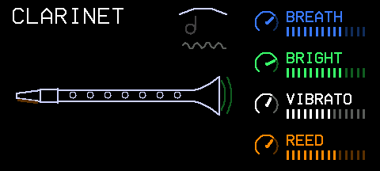

# clarinet (clarinet.pack)

**Quick start (one page):** [docs/clarinet-quickstart.pdf](../../docs/clarinet-quickstart.pdf).

**clarinet: a reed-model synth engine.** A clarinet in TE's engine list (shift + T1). The sound is a physical model,
not samples: a reed that beats against the mouthpiece, the air through it, and the bore as a tube, all in fixed point.
It has its own animated face and five sounds. Long notes keep breathing; slurs change holes, they never slide. Part of
the **engines 2** release. **[The clarinet manual](MANUAL.md)** has every gesture and the sounds in detail.

**Version 16, released in engines 2**, level 9, for OP-1 Field OS 1.7.3+0 with open-field 0.12 or later. **Native:** it
renders through Faust's level 9 engine interface alone: each of the unit's voices holds a whole model and the model is
handed on from voice to voice, so slurs open the hole inside one model as before. The unit's envelope, velocity, pan,
mix, T3 effect and fx train apply to it; synthbus is no longer needed. Its sounds carry the unit's POLY play mode and a
raised volume (the native engine sits at TE's engine level).

## Screenshots

| | |
|---|---|
|  |  |
| **T1 face** (unit, zprobe screenshot): the clarinet with its tone holes; BREATH, BRIGHT, VIBRATO, REED. |  |

## Gestures

| Gesture | Does |
| --- | --- |
| shift + T1 | TE's engine list: pick **clarinet** |
| 1st knob | BREATH: how hard you blow (soft and woody to loud and buzzing) |
| 2nd knob | BRIGHT: dark to bright (less loss in the bore) |
| 3rd knob | VIBRATO: depth of the vibrato that grows into long notes |
| 4th knob | REED: the embouchure (a looser or firmer reed) |
| shift + 1st knob | NOISE: breath noise and turbulence; fully down none at all |
| shift + 2nd knob | RATE: vibrato speed |
| shift + 3rd knob | SCOOP: how far each tongued note bends up from below (upper half: up to 3 semitones into a phrase) |
| shift + 4th knob | LEGATO: OFF (every note tongued) or SLUR (overlapping notes slur) |

It plays one note at a time; the last key held wins, and letting it go returns to the key still held. Velocity sets how
hard the note is blown.

**Sounds:** ballad, chalumeau, creole, klezmer, swing. The pack carries them; they appear in TE's sound list for the engine. A
sound saved on the engine keeps it.

Knobs are the 1st to 4th encoder from the left; "A + B" means hold A, then press B.

## Needs and works with

- Needs: base.pack (level 9). Nothing else.
- Works with: TE's T3 effect, snowtrain and fx train, directly. CHERD, MIDI in and tape MIDI play it like any engine;
  chords play their last note, as it is one voice.

## Files on the unit

None of its own. Its five sounds go into `user/synth_presets/clarinet/`.

## Install and remove

With Faust's install page (its packs section), or by hand: unit in disk mode, copy `clarinet.pack` into the folder
`packs` (bootloader drive mode: `user/pk`), leave disk mode, switch the unit off and on. To remove it, delete
`clarinet.pack` from the same folder and restart. Sounds saved on the clarinet need the pack to sound like a clarinet.
**Holding HELP while switching on starts with no packs.**

