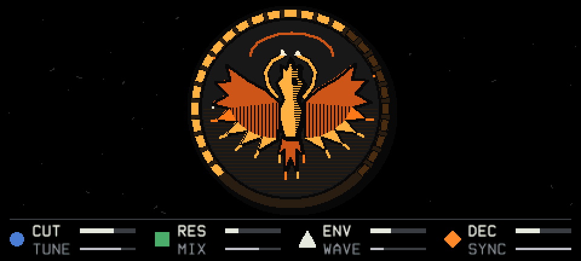

# lilith manual

**A mono virtual-analog bass engine for the OP-1 Field.** lilith.pack 16, for OP-1 Field OS 1.7.3 (+0 or +1) with Faust's
[open-field](https://github.com/LaP0573/open-field) 0.12 or later. Released as **engines 2**.

lilith is a new synth engine in the unit's engine list, beside TE's own. Two oscillators run into a four-pole ladder
low-pass filter in the Moog style, and every note opens the filter with its own decay envelope: the classic recipe for
round basses, squelchy acid lines and brassy leads. Her T1 page is an animated face. hasis made her first for the OP-XY, where she
is a bass machine of the same name; on the Field she is a little "more Moog" (a rounder filter drive, slightly unequal
filter poles, a slow pitch drift per oscillator).

Knobs are named by position: the **1st knob** is the leftmost encoder, the **4th** the rightmost. **A + B** means hold
A, then press B.

**Contents:** 1 Quick start · 2 The knobs · 3 The face · 4 The ten sounds · 5 With TE's pages and other packs ·
6 Install and removal · 7 Limits · 8 Reference card

## 1. Quick start

1. Copy `lilith.pack` into the unit's folder `packs` (chapter 6) and switch the unit off and on.
2. In synth mode, press **shift + T1**: TE's engine list opens. Pick **lilith**.
3. Play the keyboard. T1 shows her face.
4. Turn the 1st knob (cutoff) down and the 2nd (resonance) up, then the 3rd (envelope amount) up: each note now opens
   the filter with a squelch. The 4th knob sets how long that takes to close again.
5. Load one of her ten sounds (chapter 4) the way you load any sound on the unit; they sit under lilith.

## 2. The knobs

Each knob has two values: turned plainly, and turned while you hold **shift**. The face's bottom strip shows both rows.

| Knob | Turn | shift + turn |
| --- | --- | --- |
| 1st | **cutoff** (CUT): the filter's opening. The lowest setting is about 110 Hz, so the bottom stays audible on a small speaker; the filter follows the keyboard partly, so high notes stay bright | **tune** (TUNE): the second oscillator. Middle = unison; a little off the middle = a slow beating detune; the ends = an octave down and an octave up |
| 2nd | **reso** (RES): resonance, the peak at the cutoff. High settings ring and squeal | **mix** (MIX): left = first oscillator alone, middle = both, right = second oscillator alone |
| 3rd | **eg amt** (ENV): how far each note's envelope opens the filter above the cutoff (up to six octaves) | **wave** (WAVE): saw at the left, square at the right, a blend between; both oscillators take it |
| 4th | **decay** (DEC): how fast that envelope closes again, from a few milliseconds to about two seconds | **sync** (SYNC): off in the lower half, on in the upper half. On, the second oscillator restarts with every cycle of the first: turn **tune** for the hard-sync sweep |

Tips:

- **A classic bass:** cutoff low, reso a quarter, eg amt half, decay short; mix on the first oscillator.
- **Acid:** cutoff low, reso high, eg amt high, decay short; play short notes and ride the 1st knob.
- **Fat:** mix in the middle and tune a hair off the middle, or an octave down for weight.
- **Sync lead:** sync on, mix to the right, then sweep tune.

**She is mono**, like the Moog basses she comes from: one note at a time, **the last key pressed**. Hold C, press E,
let E go, and C sounds again. Press three keys and you hear the last one.

**Legato:** a key pressed while another is still held does not restart her filter envelope; the oscillators and the
filter carry on, and the pitch **glides** to the new note in about 40 ms. Play overlapping notes for slides (the acid
trick), detached notes for a fresh envelope on each. A key pressed from silence always starts the envelope again.

## 3. The face

T1 shows her face whenever the sound's engine is lilith. Everything on it moves with what you play:

- **The ring** around the medallion is the filter: its lit part grows with **cutoff**, and each note's envelope sweeps
  further around it (**eg amt**), then falls back (**decay**).
- **On a note** rays burst out of the medallion, the phoenix lifts its wings and its eye lights up; it breathes while
  you hold the key.
- **Her song** (a picture of the two oscillators) streams out on both sides while she sounds.
- **Arcs** rise from her beak with **resonance**: more and faster as you turn it up.
- **Feathers** ignite with the filter's opening; **flames** at the horn tips grow with resonance, at the tail tips with
  eg amt.
- **Embers** drift up from the wings and tail; how many follows **decay**.
- **The strip** along the bottom: one column per knob, the 1st on the left. The top bar is the plain value (CUT, RES,
  ENV, DEC), the bottom bar the shift value (TUNE, MIX, WAVE, SYNC). Each column also has its knob's own mark: a dot,
  a square, a triangle and a diamond, from left to right.

## 4. The ten sounds

The pack carries ten sounds. open-field writes them into `user/synth_presets/lilith/`, where the unit finds them with
its own sounds. Pick them as you pick any sound; a sound you save on lilith keeps her.

| Sound | What it is |
| --- | --- |
| **acid** | The squelch line: low cutoff, high resonance and envelope, short decay, first oscillator alone, an octave down. |
| **bass** | A round, plain bass: the starting point. |
| **brass** | Brighter, both oscillators a hair apart, a slower decay: stabs and brassy leads. |
| **funk bass** | The second oscillator an octave down under the first, a touch of square, a long decay: a thick slap. |
| **glide lead** | Two detuned oscillators halfway to square: a singing lead. |
| **prog lead** | Two detuned saws, a medium envelope: the long lead line. |
| **seq bass** | A tight bass for sequencer lines. |
| **squelch** | Close to acid with more resonance and a longer decay. |
| **sync** | Hard sync on, the second oscillator up: the tearing sync lead. Sweep tune (shift + 1st). |
| **tortoise** | Pedal-style sub bass: two octaves down, the second oscillator an octave below, low cutoff, a long decay. |

## 5. With TE's pages and other packs

- **T2, the envelope:** TE's amplitude envelope shapes her as it shapes any engine (her filter envelope is the 3rd and
  4th knobs).
- **T4, the LFO:** TE's LFO moves her knobs as it moves any engine's.
- **T3, the effect:** TE's T3 effect, snowtrain and fx train work on her directly, as on TE's own engines.
- **Velocity:** the unit's velocity sets her loudness, as for TE's own engines.
- **CHERD** (chord sequencer, its own release): its arpeggios play on her; a chord sounds as its last note. So do TE's sequencers.
- **BEIGNET** (fx 1.1; in wagons since wagons 18) on the master works on her like on everything else.

## 6. Install and removal

**Needs:** an OP-1 Field on **OS 1.7.3** (the +0 and +1 releases both work) with open-field installed by Faust's install page (it puts the
loader and `base.pack` on the unit; open-field's `docs/guide.md`). Nothing else.

**Install by hand:**

1. Download `engines-2.zip` from the releases repository's Releases and unzip it (check it against `SHA256SUMS` if you
   like).
2. Put the unit into disk mode and copy `packs/lilith.pack` into the unit's folder **`packs`** (in the bootloader's
   drive mode: `user/pk`).
3. Leave disk mode and switch the unit off and on.

Or, once lilith is listed there, tick her on open-field's install page.

**Remove:** delete `lilith.pack` from the folder `packs` and restart. Her ten sounds stay in
`user/synth_presets/lilith/`; delete that folder as well if you want them gone.

**If something goes wrong:** hold **HELP** while you switch the unit on and no pack loads; then delete the file that
misbehaves.

## 7. Limits

- OS 1.7.3 (+0 or +1), with open-field.
- No settings or files of her own besides the ten sounds.
- She renders in the unit's own voices through open-field's engine interface and shows under her own name; TE's engines all stay.

## 8. Reference card

| Gesture | Does |
| --- | --- |
| shift + T1 | engine list: pick lilith |
| 1st / 2nd / 3rd / 4th turn | cutoff / reso / eg amt / decay |
| shift + 1st / 2nd / 3rd / 4th turn | tune / mix / wave / sync |
| T1 | her face |
| HELP at power-on | safe start: no packs load |

**Unofficial.** Not made, endorsed or supported by Teenage Engineering, and not affiliated with them. MIT, 2026 hasis.
