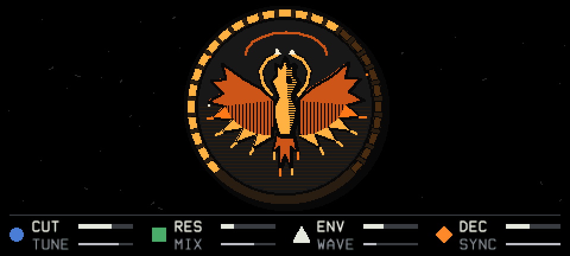

# lilith.pack

**Quick start (one page):** [docs/lilith-quickstart.pdf](../../docs/lilith-quickstart.pdf).

**lilith: a mono virtual-analog bass engine.** A new synth engine in the unit's engine list: two oscillators (saw to
square, the second one tunable and with hard sync) into a four-pole ladder low-pass filter in the Moog style, with its
own decay envelope on the cutoff. Her T1 page is an animated face, a phoenix in a medallion that moves with the knobs
and the notes. Ten sounds come with her.

**Version 16, released in engines 2** (`engines-2.zip`), for OS 1.7.3 (+0 or +1) with open-field 0.12. **Native:** she renders
through Faust's level 9 engine interface alone, like other developers' engines. The unit's envelope, velocity, pan, mix,
T3 effect and fx train apply to her as to its own engines; synthbus is no longer needed and the pack asks nothing but its
engine. Her sounds carry the unit's POLY play mode (her own render keeps her mono). The file: [`lilith.pack`](../lilith.pack).
**The manual: [MANUAL.md](MANUAL.md)** (every knob, the face, the ten sounds, what she works with, install and removal).

## Screenshot

**T1 face**, captured on an OP-1 Field: her phoenix in the filter ring; along the bottom the four knobs, top row
turned plainly (CUT, RES, ENV, DEC), bottom row with shift (TUNE, MIX, WAVE, SYNC).

## Gestures

Knobs are the **1st to 4th encoder from the left**. "A + B" means hold A, then press B.

| Gesture | Does |
| --- | --- |
| shift + T1 | TE's engine list: pick **lilith** |
| 1st turn | **cutoff** of the ladder filter |
| 2nd turn | **reso**nance (high settings squeal) |
| 3rd turn | **eg amt**: how far each note's envelope opens the filter |
| 4th turn | **decay** of that envelope |
| shift + 1st turn | **tune**: the second oscillator, an octave down to an octave up, unison in the middle |
| shift + 2nd turn | **mix**: first oscillator alone, both (middle), second alone |
| shift + 3rd turn | **wave**: saw to square, both oscillators |
| shift + 4th turn | **sync**: off in the lower half, on in the upper half |

**Mono:** one note at a time, the last key pressed (let it go and she drops back to the newest key still held). A
key pressed while another is held plays legato: her filter envelope keeps running and the pitch glides there in about
40 ms. A key from silence starts the envelope again.

TE's own pages stay TE's: T2 is the amplitude envelope, T4 the LFO (it moves her knobs as it moves any engine's).

**Sounds:** acid, bass, brass, funk bass, glide lead, prog lead, seq bass, squelch, sync, tortoise. The pack carries them;
open-field puts them into `user/synth_presets/lilith/`, beside the unit's own sounds.

## Needs and works with

- **Needs:** an OP-1 Field on OS 1.7.3 (+0 or +1) with open-field installed (its `base.pack`). Nothing else.
- **Works with:** CHERD (its arpeggios play on her; a chord sounds as its last note), TE's sequencers and the keyboard, BEIGNET (wagons) on the master, tape.
- She plays in the unit's own voices, before the T3 effect: TE's T3 effect, snowtrain and fx train change her sound directly. No synthbus.

## Files on the unit

The ten sounds in `user/synth_presets/lilith/`. Nothing else.

## Install

With the install page of open-field (its packs section), or by hand: unit in disk mode, copy `lilith.pack` into the
folder `packs` (drive mode: `user/pk`), leave disk mode, switch the unit off and on. **Holding HELP while switching on
starts with no packs.** To remove her, delete `lilith.pack` (and `user/synth_presets/lilith/` if you want the sounds
gone too).

