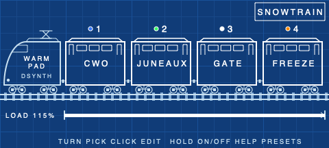
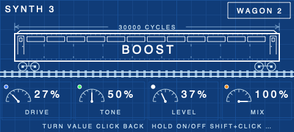
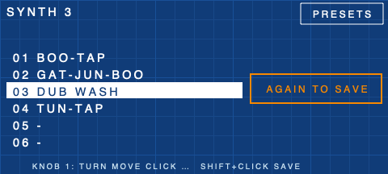
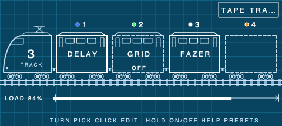

# snowtrain.pack

**A light fx train.** A train on the synth, the drum and each tape track: the locomotive is the sound (SYNTH 3, DRUM 1)
or the track (TRACK 2), then four wagons. On a sound, wagon 1 is TE's own T3 effect and wagons 2 to 4 are any pack
effects on the unit (wagons, beignet, TUNE, anyone's level-8 effect). On a tape track all four are TE's effects. Knob N
is the wagon drawn above it. Part of the **fx 1** release.

|  |  |
|---|---|
|  |  |

(Renders by the pack's own drawing code, `check.sh`; the unit draws the same faceplate.)

Version 17, level 8, OP-1 Field OS 1.7.3+0, open-field 0.12 or later (Faust's stock base 32 or ours).

## In short

- **Open:** T3 on a synth or drum screen. On the mixer, **shift + the Nth knob's click** opens track N's train.
- **Turn** a knob: pick that wagon's effect. **Click**: its values. **Hold**: on / off. **Shift + turn**: move it.
- **HELP**: presets (`user/pf/snowtrain/`, 16 factory chains on the first start).
- **Settings:** none. The chain is kept with each sound (and the sound's presets); a track's train with its tape.
- **Install:** copy `snowtrain.pack` into the unit's pack folder (see the repository's README), or pick it on Faust's
  install page once it is listed. **Not beside fx train**: take fx train off (both use the same two places; the loader
  keeps fx train and leaves snowtrain out).

### On Faust's stock base and 8 tracks (fx 1)

- **NO MEMORY on a wagon:** the stock base keeps one memory record for every effect ever picked into each wagon, until
  the unit restarts. snowtrain only makes a new one once the knob has rested 0.7 s, so scrolling past names costs
  nothing; if a wagon still says NO MEMORY, **restart the unit**. A base with the rack fix (proposed to
  open-field) reuses records and never runs out.
- **CPU OFF on a wagon:** the base's cycle guard switched that effect off in that wagon because it ran too long. On the
  stock base it stays off until the unit restarts (the fix re-arms it on a new pick).
- **The install question** (T1 / T2, when packs arrive over the door) and the options page show over the train on
  every base: snowtrain steps aside while they are up and comes back after.
- **Tape track trains** need no 8 tracks, or 8 tracks 13 (ours). With Faust's 8 tracks 11 they are not offered:
  shift + click on the mixer stays the unit's, and the log says why.

## Needs and works with

- 8 tracks (optional): with 8 tracks 13, tracks 5-8's trains and its own function at the tape mixer's call runs tracks
  1-4's. With 8 tracks 11 (stock) the tracks' trains are not offered (nothing would run them).
- tape train: take it off. snowtrain does its work; with both in a set the loader keeps snowtrain (the earlier file)
  and leaves tape train out (the same names offered, the same place).
- The base's install question (T1 / T2) and its options page come over the train: snowtrain steps aside while they
  are up. Base 33 says so in the frame; on any base the screen's page is then not snowtrain's faceplate
  (`op1f_screen(77)`), which is what snowtrain looks at. No zprobe needed.

