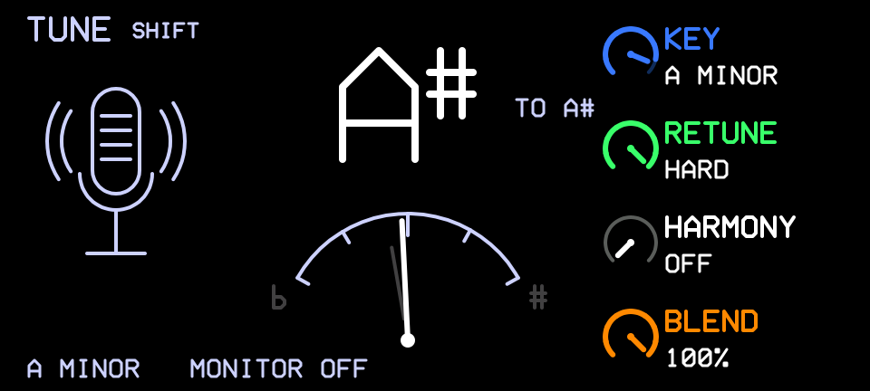

# TUNE (tune.pack)

**TUNE: pitch correction on the input, and as an effect.** TUNE corrects the live input (mic, line in, USB) to a key or
to CHERD's chord, with harmonies, on its own page; and it is a **TUNE** effect in TE's effect lists (T3) for every
sound, and a wagon on snowtrain or fx train. Part of the **fx** release. The DSP is xy-machines' pitch correction
for the OP-XY (MIT; see the third-party notices).

**Upgrading from fx 1.0:** the file was `autotune.pack`; it is `tune.pack` from tune 28 (fx 1.1).
**Delete `autotune.pack`** from the unit's `packs` folder when you copy `tune.pack`. Both offer the same names, so with
both there the loader runs the earlier file by name, `autotune.pack`, and leaves `tune.pack` out (the log says "an
earlier pack offers the same name"). Sounds that use the effect `tune` keep it: the effect's name did not change. The
page's settings last for the session anyway, so nothing is lost.

Version 28, level 8, for OP-1 Field OS 1.7.3 (+0 or +1) with open-field 0.12 or later.

## Screenshots

**shift + HELP page**: the microphone, the scale or chord it follows, the note it tunes to, the meter, TUNE, RETUNE,
HARMONY, BLEND. A render (texts in a stand-in font).

## Gestures

**shift + HELP** in any mode opens the page; plain HELP or shift + HELP closes it.

| Knob | Turn | Click |
| --- | --- | --- |
| 1st | TUNE, "bypass" then 7 % to 100 %; shift + turn: KEY (chromatic, C-B major, C-B minor) | - |
| 2nd | RETUNE: smooth / hard | - |
| 3rd | HARMONY: off, 3rd up, 3rd down, double, thirds, triad, octaves, choir | SNAP: AUTO, SCALE, KEY |
| 4th | BLEND (harmony level) 0 % to 100 % | MONITOR on / off |

SNAP is where the target notes come from: AUTO follows CHERD (its sounding chord, else its scale), SCALE CHERD's scale,
KEY the page's own key; the bottom line shows the result ("cherd chord", "cherd scale", a key, "chromatic"). MONITOR
sends the tuned voice through the synth bus so T3 and fx train play on it (synth mode; it turns TE's input on). It
starts bypassed at power-on; settings last for the session.

**TUNE as an effect:** in the T3 lists; its page shows the same knobs (bottom line starts with "effect", no MONITOR).

Knobs are the 1st to 4th encoder from the left; "A + B" means hold A, then press B. The full guide: [docs/PLAYERS-GUIDE.md](../../docs/PLAYERS-GUIDE.md).

## Needs and works with

- Needs: base.pack (level 8). Nothing else.
- Works with (optional, none needed): cherd (the notes follow CHERD's chord or scale), synthbus (MONITOR through synthbus; without it TUNE takes the bus place itself), fx train 18+ (TUNE's own wagon picture).

## Settings

None: it starts bypassed at power-on and its knobs last for the session. As an effect, its values are kept with the
sound like any T3 effect.

## Files on the unit

None.

## Install

From the fx release zip (see the repository's README): unit in disk mode, copy `tune.pack` into the folder
`packs` (drive mode: `user/pk`), leave disk mode, switch the unit off and on. Or with open-field's install page once it
is listed. **Holding HELP while switching on starts with no packs.**
