# VU (vu.pack)

**Quick start (one page):** docs/quickstart/vu.pdf (preview).

*Part of [field-packs](../../README.md). From the repository's root: `OPEN_FIELD=<open-field> make vu`
(`bash tools/test_pack.sh vu` for the host test).*

Called `visualizers` in version 1.

Audio visualizers for the OP-1 Field's **mixer** ([open-field](https://github.com/LaP0573/open-field) 0.12+, OS 1.7.3).
They show the **master mix** as you hear it (after the master effect), summed: not per track.

**vu 24: a host and one pack per look.** `vu.pack` is the host: the listening stage, the analysis (spectrum, beats,
levels), the blank page, the mixer key's tap, the flash, the EQ knobs and their strip, the punch hand-off. Each look is
its own small pack, so put on the unit only the looks you watch (the unit's pack room is full). **Core:** SUNDOWN,
SPECTRUM, CLASSIC, LCD, VU. **Optional:** CONSOLE, BELLA, ANDY, GOOD TIMES, SCOPE.

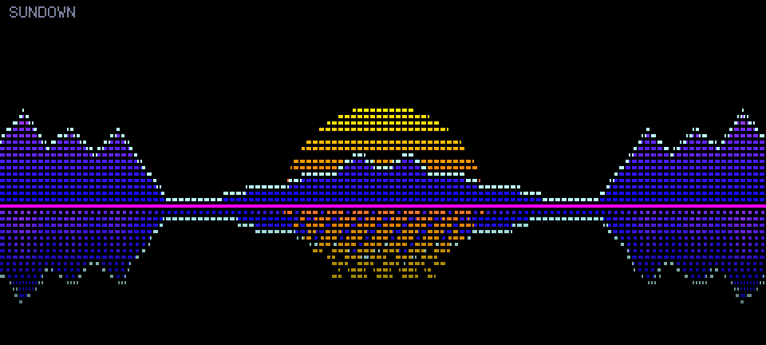

| | | |
| --- | --- | --- |
| 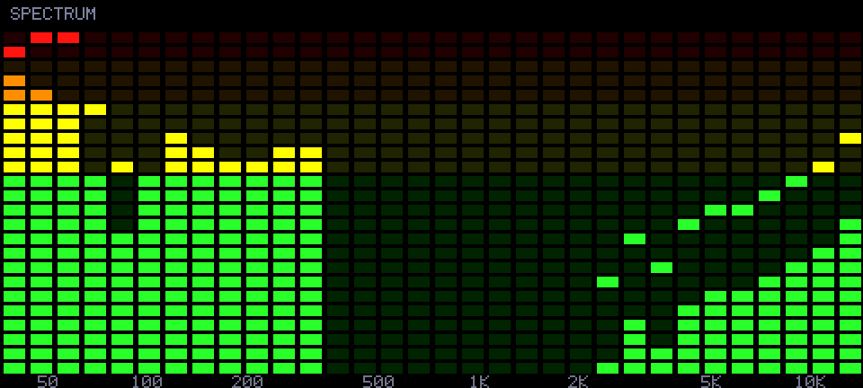 | 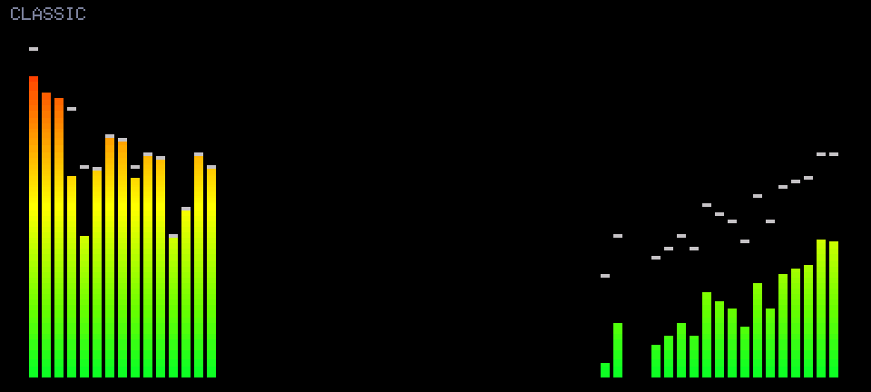 | 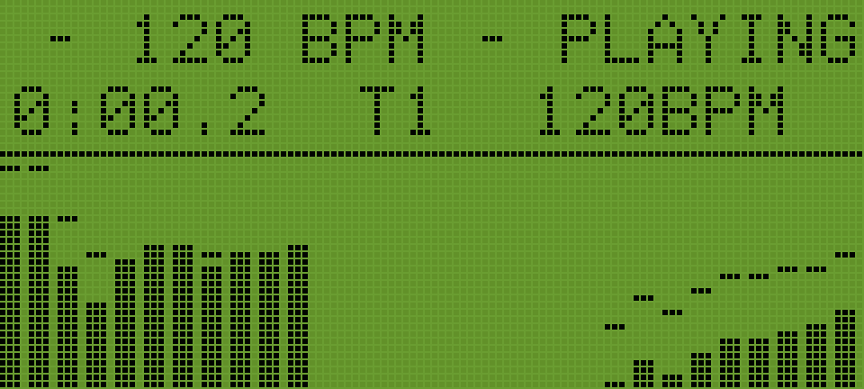 |
| SPECTRUM (core) | CLASSIC (core) | LCD (core) |
| 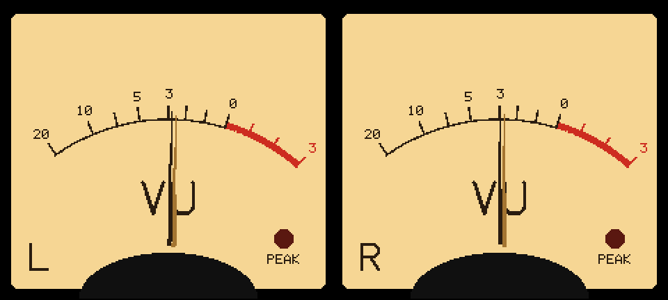 | 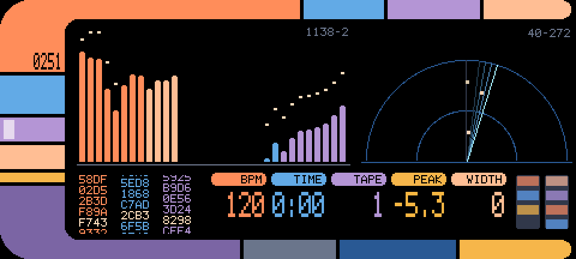 | 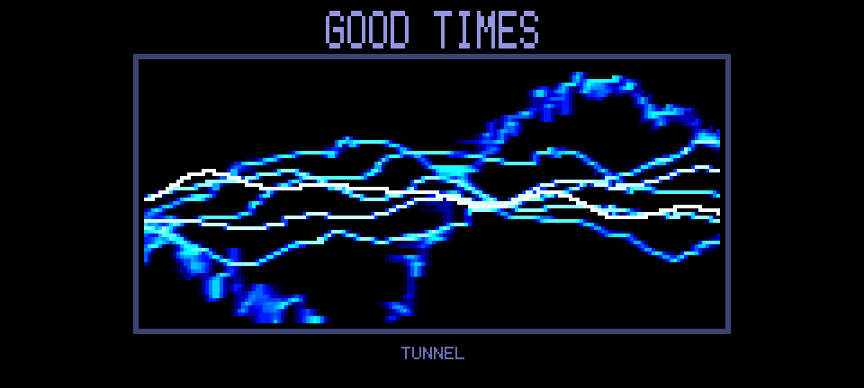 |
| VU (core) | CONSOLE (optional) | GOOD TIMES (optional) |
| 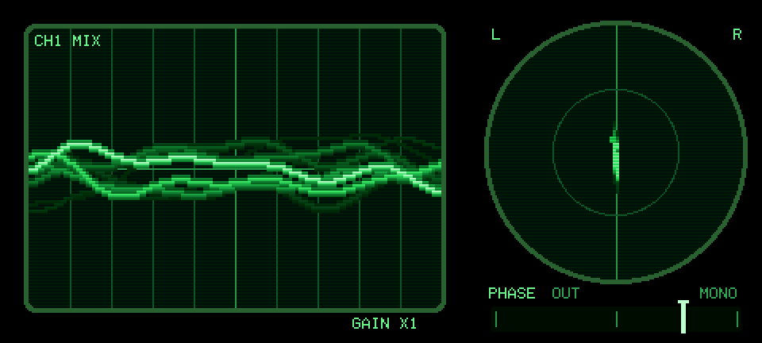 | 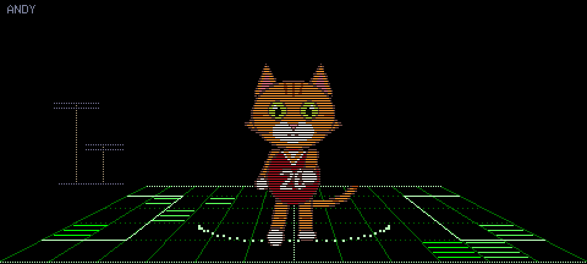 | 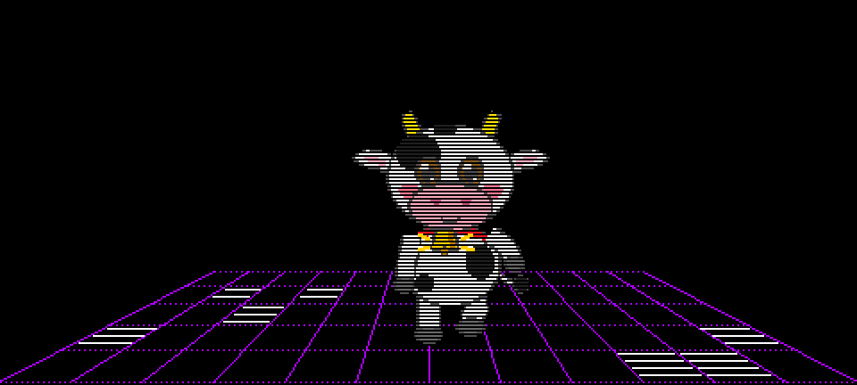 |
| SCOPE (optional) | ANDY (optional) | BELLA (optional) |

vu 34 on the host (`previews.py`'s render, a full mix, 2.5 s at 15 fps). All ten looks, three moments each:
pictures/looks_vu34.png.

| Pack | Looks | Room (body + zeroed) | Settings (vu 25: all under settings > packs > vu) |
| --- | --- | --- | --- |
| `vu.pack` (needed) | none of its own; a tap says NO LOOKS without look packs | 36 KB | **EQ knobs** on / off, **punch keys** on / off, **classic** bars / dots / lines (NOT INSTALLED without vu_classic, vu 34), **look** (the picked look) |
| [`vu_sundown.pack`](../vu_sundown/README.md) (core) | SUNDOWN (in vu_spectrum until 5) | 2 KB | none |
| [`vu_spectrum.pack`](../vu_spectrum/README.md) (core) | SPECTRUM | 2 KB | none |
| [`vu_classic.pack`](../vu_classic/README.md) (core) | CLASSIC (bars, dots, lines) | 3 KB | vu's **classic** |
| [`vu_lcd.pack`](../vu_lcd/README.md) (core) | LCD | 4 KB | none |
| [`vu_console.pack`](../vu_console/README.md) (optional) | CONSOLE | 13 KB | none |
| [`vu_goodtimes.pack`](../vu_goodtimes/README.md) (optional) | GOOD TIMES | 30 KB | none |
| [`vu_meter.pack`](../vu_meter/README.md) (core) | VU | 8 KB | none |
| [`vu_scope.pack`](../vu_scope/README.md) (optional) | SCOPE | 28 KB | none |
| [`vu_bella.pack`](../vu_bella/README.md) (optional) | BELLA (MARY BELLE's own look dropped in vu_bella 2) | 12 KB | none |
| [`vu_andy.pack`](../vu_andy/README.md) (optional) | ANDY | 29 KB | none |

vu 23 was one pack of ~175 KB holding every look. All of them as packs come to 3 KB more than that (SCOPE now has
its own phosphor memory; vu 23 borrowed GOOD TIMES'), and any smaller choice is much less.

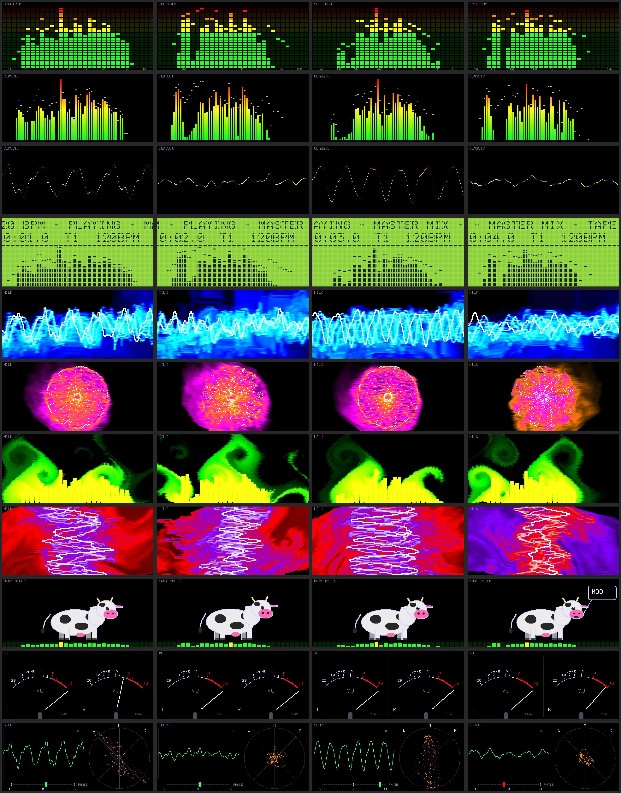

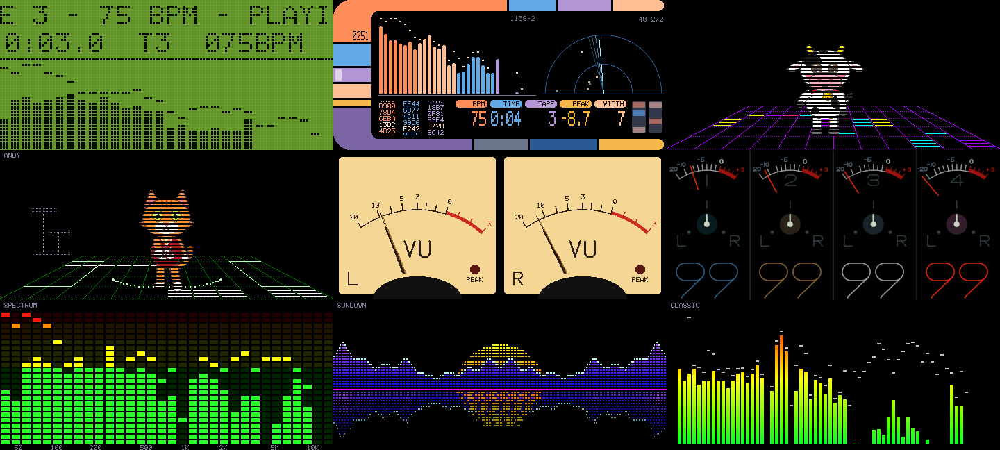

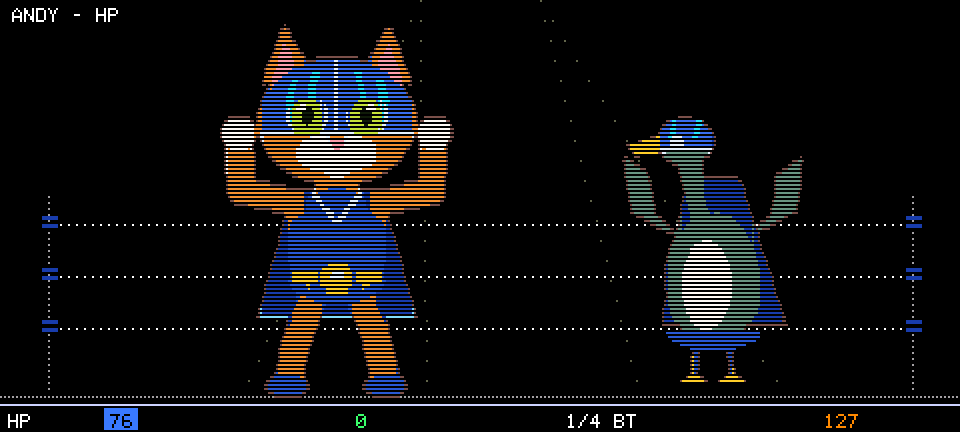

## Use

| Where | What | Does |
| --- | --- | --- |
| mixer, levels page already up | **HELP** (vu 35) | the picker: every look installed in two columns (SUNDOWN, SPECTRUM, CLASSIC, LCD, CONSOLE, GOOD TIMES, BELLA, ANDY, VU, SCOPE), the picked look marked with a dot; **1st knob** moves the box, a **click** picks that look, shows it and closes, **HELP** again (or a tap of the mixer key) closes. shift + HELP stays tune's |
| mixer, levels page already up | **tap the mixer key** (release within 0.3 s) | vu 36: **OFF (TE's mixer) ↔ the picked look**, nothing else (no stepping through the looks). Nothing picked yet: the first installed (SUNDOWN when it is there); the picked look's pack removed: the first installed; the name shows small at the top left for 1 s. **NO LOOKS** with no look pack installed (TE's mixer stays) |
| mixer, levels page up | hold the mixer key | TE's (and 8 tracks' page of tracks 5-8): a hold is never a tap |
| settings > packs > vu | **EQ knobs** on / off | on: the knobs on a look turn TE's master EQ (below); off: they stay TE's volumes |
| settings > packs > vu | **classic** bars / dots / lines | CLASSIC as the analyser, or the mix's wave in dots or lines (bars at first) |
| settings > packs > vu | **punch keys** on / off (off at first) | on: with punch 3+ the white keys on a look hold punch's effects; off: they stay TE's keys (vu 27) |
| settings > packs > vu | **look**: every look installed (a base with option words) | the picked look (vu 36: no OFF here, the tap is OFF), as HELP's picker; the picker changes it here too |

vu 25: vu's entry is the family's only one under settings > packs; a look pack installed is a look in the round (to drop a look, remove its pack).

**vu 36: pick one look, the tap switches it on and off.** HELP on the mixer (or settings' **look**) picks the look;
the mixer key's tap goes OFF ↔ that look. vu keeps on / OFF and the picked look in `user/pf/vu/look.txt` on every base
(two characters, `'0' + number`; vu 35's one character is still read), so both come back at the next start. vu 35's
**in rotation** switch and `user/pf/vu/rotation.txt` are gone: an old `rotation.txt` is ignored (a pack cannot delete a
file; delete it by hand if you like). To drop a look for good, remove its pack.

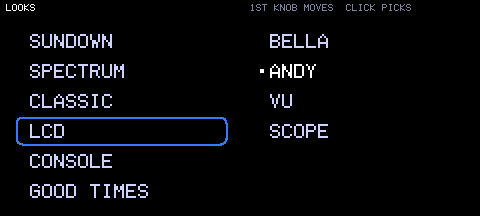

vu 26, on a base with option words (open-field PR #56, pending): **look** lists the looks whose packs are installed (vu 26-35: OFF too), by the names they register
(a pack's look is only listed when the pack is there). The base keeps the chosen look by its **name** in
`user/pf/.options` (`vu/look=SCOPE`), so adding or removing another look pack does not move it; a look whose pack was
taken off keeps its line until it is back or you pick another (vu 36: meanwhile the tap shows the first installed).
vu 36 reads `look.txt` on these bases too (on / OFF; vu 26-35 did not), and settings' **look** follows the picked look.

On a base without option words (open-field 0.24 = base 42 and older), there is no
**look** line and no **classic** line (both are options of words): the base reads EQ knobs and punch keys and leaves the
rest aside, so nothing breaks; CLASSIC stays bars. The release's `vu.pack` (vu 36) is the unit's build, made with
tools that keep the options of words (open-field PR #56, pending): it carries all four (34,592 bytes), and
look and classic appear on any base with option words. open-field's stock tools leave those two out of the card (30,800
bytes, the same code). You
pick the look with HELP's picker and switch it with a tap of the mixer key; on / OFF and the picked look are kept in
`user/pf/vu/look.txt` (the looks keep vu 23's numbers, so it carries over). At start vu waits up to 2 s for that look's
pack to register; if it is away, the tap shows the first look installed.

**From vu 23**: install `vu.pack` 24 (it replaces vu 23: same pack, higher version) and the look packs you want. The
look settings start fresh, all on: vu 23's `vu/spectrum`, `vu/extra cow mode` and the rest are not read (the look
packs have settings of their own); BELLA is no longer a hidden extra, her pack is the choice (vu_bella replaces vu_mary: delete `vu_mary.pack`). With vu
23 still installed and no vu 24, look packs do nothing (they ask for vu 24's register, a weak name), and nothing breaks.

The tap is decided when you let go:

- **Held** longer than 0.3 s, or with a knob turned or a key pressed meanwhile, the mixer key is still 8 tracks' page of
  tracks 5–8. The look keeps painting for the first 0.3 s of a press, so a tap doesn't flicker.
- **No tap** from the press that brings the mixer up from another screen.
- **No tap** on the EQ, effect or drive page. There the key takes you back to the levels page, as TE's does.

Every look's own description is in its pack's README (links above). Common to all:

- **Words and numbers**: every small one is the same 5 x 7 pixel font at whole-number scales (x1 labels, 2 x 3
  readouts), crisp on the Field's own screen.
- **CLIP**: a filled box with the word in it, at the top right, for 1 s after any sample at -0.1 dBFS or above.

Hue never carries meaning on its own. Peak, clip and the zone above 0 VU are each marked by a shape or a word.

**The base's top page** (the door's install question) is never covered. The visualizer stands back while it is up: it
reads the frame's `OP1F_POPUP_TOP` on base 33+, and zprobe's `op1f_door_card_up` on Faust's base when zprobe is there.
The unit's settings are on screens of their own, so the visualizer is never painted over them.

**The knobs on a look turn TE's master EQ** (vu 21). 1st LOW, 2nd MID, 3rd HIGH, 4th ALL (the three bands up or down
together, refused at an end so the shape comes back exactly). A line at the bottom says `LOW +3  MID 0  HIGH -2  ALL 0`
for 1.5 s after the last turn (vu 34: one 14 px line, the small font, under the four knob positions; the turned one in a box). These are TE's own values, so TE's EQ page (T2) shows the same.
TE's 4th knob there (CLEAN / MAX EQ) flattens the bands to one value, so it is not on a look. Setting **EQ knobs**
off leaves the knobs TE's on a look too. With **punch** 3 and **punch keys** on (vu 27; off at first) the
white keys hold punch's effects on a look (at most 4) and a held key's knobs are that effect's. vu 34: holding shows
no strip, only the effect's name small beside the look's at the top left (`ANDY - HP`); turning its knobs shows the line:
the effect's name (`+1` when more are held), then its four values under the four knobs, the turned one boxed for 0.6 s.
**Markers' cue on a look** (vu 34, markers 94): shift + a key cues that marker exactly as on the tape screen (a press cues,
twice jumps, held 0.5 s loops); its name flashes small at the top left (`NO MARKER` for a key without one). Plain keys
stay punch's (punch keys on) or TE's. Without markers, shift + a key is TE's as before. On OFF the knobs are TE's again (volume; with shift, pan).

**Punch's effects on the looks** (vu 33). While one of punch's effects is held (a white key on the PERFORM face or on a
look, a PUNCH lane, a MIDI program change), vu reads punch's view once a frame (`op1f_punch_view`, weak: without punch
nothing changes) and hands the looks the effect, its family, its depth (the 4th knob when its knobs are shown, else
punch's own default; ISO full) and a strength that rises in ~85 ms to 96 + the depth and falls back in ~0.5 s when it is
let go (`vz::fx()`, a field at the end of the kit: a look on an older vu sees nothing held). Families: **filters** LP
HP JET ISO, **time and space** DUB VERB RISE, **repeats** STUTR GLITCH GATE PUMP, **destruction** CRUSH DIVE SCRATCH.
Colour is the fun layer; every family also reads by shape, brightness or motion:

| Look | filters | time and space | repeats | destruction |
| --- | --- | --- | --- | --- |
| all colours | ice (blue to ice white) | nebula (purple to pink white) | amber (gold, cream) | heat (red to white hot) |
| SPECTRUM | hollow bars, the outline thicker with the depth | a ghost trail up to the held peak, two echoes above it | the bars strobe dim on every other sixteenth | bars crushed to steps of three segments |
| SPECTRUM, all | lightning crackling off the bars at their peaks while held, more with the depth (twice as many for destruction) | | | |
| CLASSIC bars | hollow bars | two echoes over each cap | strobe | 16 px steps, lightning off the tallest caps |
| CLASSIC dots / lines | a thick trace | an echo of the trace above it | strobe | the wave in 8 px steps |
| SUNDOWN | the sun in blinds | the water ripples wide | the sun strobes out | mountains in steps, lightning on the two highest peaks |
| LCD | the line leads with `PUNCH <effect> <depth>`; the backlight in the family's colour, steady | breathing | strobing | flickering |
| CONSOLE, VU, SCOPE, GOOD TIMES | tinted, steady and muted | breathing | strobing on the sixteenths | flickering | 
| ANDY | she and the seabird are big masked luchadores in a ring: the double biceps flex, striped masks | the high flyer, arms spread, a star on the mask | the taunt, a fist pumped up on alternate beats, diamonds | the power stance, claws out, flames round the eyes |
| BELLA | a luchadora: her mask with stripes, a cape; the floor's lines flash on the beats | a star | diamonds, the lines flash every sixteenth | flames |

No frame costs more with an effect held than without (the cost model's average and worst a look, `viz_test.cpp`), as
the looks leave the rows under vu's strip black (`fx().kept`) and the strip writes only its line and words there; vu's
strip itself is in words now (it was single pixels: ~0.4-0.75 M cycles on any frame with punch held). SCOPE alone stays
over by the strip (its CRTs are vu's art(), which cannot leave rows out; it is not in the sets).

**TE's own mixer still works.** T1–T4, shift + T1–T4 (mutes), the knob clicks, holding the mixer key (8 tracks' tracks
5–8) and shift + a knob click (the trains) all do what they did before. Clicking a knob shows TE's levels page for
1.5 s. Then the look comes back. The visualizer stands back
for TE's popups, any pack's page, the power popup and 8 tracks' page.

**With lanes** (89MPH / LCARS): lanes' file sorts first, so it paints the mixer its way. A look that is on paints over
it. With OFF you get lanes' (or TE's) mixer. `op1f_vu_on()` answers 1 on a frame this pack painted, so lanes
can skip its own drawing there.

## How

- **Audio thread**: one stage that only listens at `master_out`. It copies each block into three rings: L, R, and a
  mono sum averaged over 4 frames, 1024 samples each. On the unit that costs 3,600 cycles a block on average (9,900 at
  most), and the stage declares 12,000.
- **Painted on the base's blank page** (vu 16): every look is painted on the base's blank page, black and new every
  frame, so black is never written. The firmware-drawn pictures of vu 10-15 (`vu_pages.py`, `vu_dress.h`) cost the
  firmware 7-30 ms a frame; vu 24 leaves their code out (git history has it).
- **The looks' registry** (vu 24): a look pack calls `op1f_vu_register_look(VuLook*)` (weak) at its first frame with
  each look's number (vu 23's, 1..11; 12..15 free), name, flags, a cost hint and its `paint()`; vu answers with the kit
  (`viz.h`'s `VuKit`: the analysis, `scope_gain`, the sprite and art painters, the pixel font, lines, rounded boxes), so
  no look pack carries its own copy. A look's `paint()` asks for the analysis it needs and paints its frame; vu keeps
  the frame's bookkeeping, the header, CLIP, the flash and the strip. A look of another kit number is refused (logged).
- **Display thread**, only while a look is shown. Every look draws straight onto TE's frame, each pixel once, two rows at
  a time where it can. Each frame runs one 512-point FFT, the low and the full one in turn. After a frame over ~8 ms the
  next skips its analysis. The log gives each look's cost (analysis and drawing), and all looks in one line. Estimated
  frame costs, calibrated on the unit's vu 8 numbers (to be confirmed on the unit):
  - SPECTRUM: two 1024-point fixed-point FFTs with a Hann window. The bands under 1.2 kHz come from the 11 kHz ring
    (10.8 Hz a bin), the rest from the full-rate one.
  - VU: a 512-sample rectified average.
  - SCOPE: the last 512 samples.
  - Every frame, the whole screen is painted over TE's: whole columns, as 32-bit words.
- No float, no 64-bit, no divide except one software divide a frame (the phase bar). The log reports the cycles of each
  frame and of the stage's most expensive block every 10 s.
- `viz.h` is the model (rings, FFT, State, analysis, drawing, the kit, the frame, the tap and the gate), `vu_eq.h` the
  EQ and punch cells, `vu_pack.cpp` the card and the registry, `vu_look_pack.h` a look pack's card side,
  `meter_art.py` makes `meter_art.h` (VU, SCOPE and CONSOLE's still art); `art_words.py` makes `art_words_data.h` from it,
  VU's and CONSOLE's art as word runs for the looks' painter `art_words.h` (rerun it after `meter_art.py`). `viz_test.cpp` is the host check: it takes
  every look pack in the checkout (`viz_looks.h`); `previews.py` renders GIFs and the sheet from a WAV.

Cost a frame on the unit (k cycles, 400 a us; the log's `vu looks` line, tape playing, 2026-11-25 on vu 31), and the
three looks made faster since, as host estimates on the model calibrated on those readings (to be measured):

| Look | Average | Most | Hint |
| --- | --- | --- | --- |
| SPECTRUM | 687-689 | 1011-1404 | 689 |
| SUNDOWN (vu_spectrum 4, vu_sundown 1) | ~600 (host estimate; 1358 on vu_spectrum 3) | ~900 (2426-2440) | 600 |
| CLASSIC bars | 415-428 | 871-1739 | 421 |
| LCD | 910 | 1420-1426 | 910 |
| CONSOLE (vu_console 3) | ~700 (host estimate; 1053-1319 on vu_console 2) | ~950 (1787-3331) | 700 |
| VU (vu_meter 3) | ~720 (host estimate; 1173-1203 on vu_meter 2) | ~730 (1638-4367) | 720 |
| BELLA | 624-633 | 1101-1540 | 628 |
| ANDY | 674-708 | 1085-1330 | 690 |

"Most" includes whatever else the unit runs in that frame (the tape, the audio thread): CLASSIC's 0.42 M average saw
a 1.74 M frame.

The pack logs the real numbers. Since vu 19 the calibrated model also counts the sprites' runs (~102 cycles each) and
pixels alone in a column (~65), fitted on the unit's numbers (vu 23's MARY BELLE ~1.0 M / 1.36 M). The log's `vu looks` line gives each look's
average, most and its pack's hint (k cycles). vu 24 splits nothing in a look's frame: every look's cost on the model is
vu 23's to the thousand.

The looks of the old desktop players are riffs in our own drawing: no names, logos, skins or assets of theirs.

Calibration constants to tune on the unit: `SPEC_GAIN_DB` (where the spectrum sits) and `VU_REF` (0 VU = a sine's
rectified average at -20 dBFS), both in `viz.h`.
