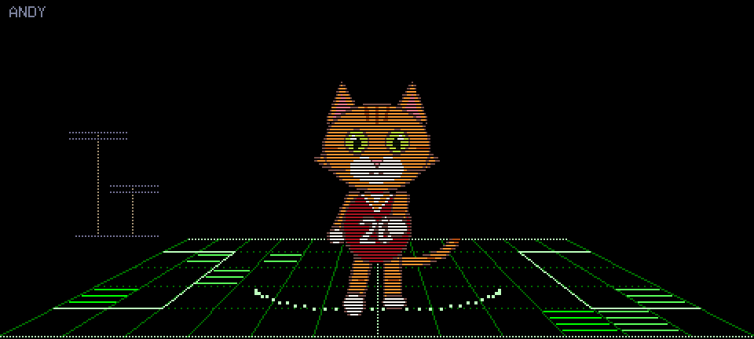
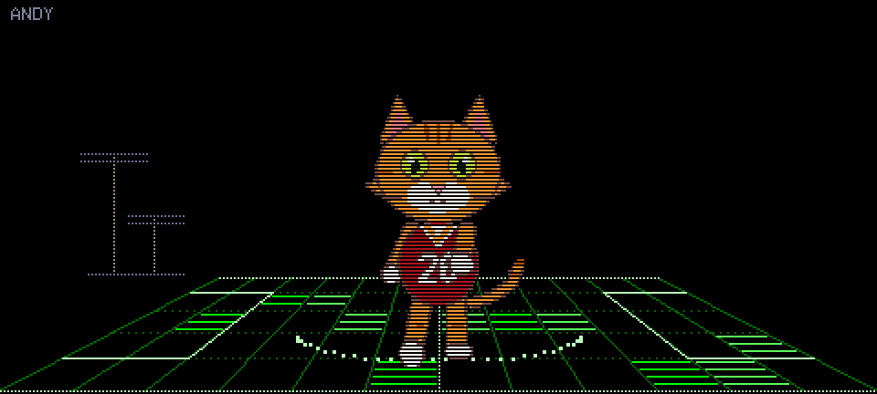
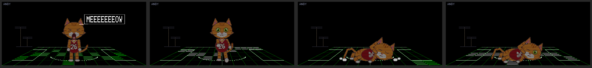

# ANDY (vu_andy.pack)

*Part of [field-packs](../../README.md), a look pack of [vu](../vu/README.md) 24. From the repository's root:
`OPEN_FIELD=<open-field> make vu_andy`; its tests: `bash tools/test_pack.sh vu_andy` (`andy_test.cpp`, run through vu's test program).*

Needs **vu.pack 24 or later** on the unit: the look registers with it at the first frame, and vu paints it on the mixer's
levels page, steps to it with a tap of the mixer key and turns TE's EQ with the knobs on it. Without vu 24 the pack does
nothing (an older vu does not know it).

| Where | What | Does |
| --- | --- | --- |
| settings | none of its own (since vu 25) | in vu's round while installed |

## The look

**An optional look:** install it if you like it; the core looks are SUNDOWN, SPECTRUM, CLASSIC, LCD and VU.

**vu_andy 2, in BELLA's universe**: she is drawn as BELLA is, at 3/4 in LED rows (every other row lit, baked so by
`andy_sprites.py`), her outline a warm grey on black; all her behaviours as before. Her stage is BELLA's floor, a bit
more soccer: a perspective grid dotted dark green, the far and near touchlines, the halfway line, the front of the
centre circle and a penalty box edge each side as bright LED lines, and a cell a column lit with its bands (bass left,
highs right, depth by level) in pitch greens, white on a kick; no spectrum strip. The cat tree is an LED outline behind
the pitch, the seabird and the cup her LED sprites. The MEOW bubble is BELLA's: straight LED edges, a 1 px tail.
Nothing is painted before the base's blank page is up. Cost on the model that matches the unit's BELLA: ~0.86 M a
frame on average, 1.15 M at worst (a loud test 0.81 / 1.08); BELLA's worst ran ~1.35 x the model on the unit, so
watch the log's "most".

vu_andy 4: the unit measured 3.78 M at most (4 frames over vu's 3.2 M guard in 10 s) while she lay on a silent playing
tape; no state or change between states goes over 1.12 M on the Mac's model (her drawing is unchanged, frame for frame).
So a second log line every 10 s times her own paint apart from vu's frame: `vu_andy: dearest paint N cycles (analysis
A), K paints over 3.2 M; it was state, mode, quirk, ms into it, clock (ms & 4095), ms after the frame before, ms after
she came up, frames on the blank page; her last log lines L cycles`. Her dearest paint near 1 M while vu's "most" says
3.7 M means the long frames are not hers (another thread over the display's, the tape's disk, the logger).
vu_andy 6 (vu 32): her lines are logged from her pack's frame function, outside vu's timed span (they were counted as
her frame: 5.37 M at most after a restart); her hint lives in one place (`ANDY_HINT`, 690).

 (moving, with a MEOW and the plop: pictures/andy.gif)

- **ANDY** (Andruella Robertson), an orange tabby who does the Griddy and plops. In the round while vu_andy.pack is installed.
  - Her own stage, a few thin cues of a football ground on black (no club's name, crest or colours; she is the star):
    a dotted touchline, the halfway line, the front of the centre circle, two floodlight outlines, a few dots in the
    stands. A small cat tree in outline (a post, two platforms) stands behind her, and she ignores it, except when she
    stares at it and turns away.
  - Our own cat, a chibi in MARY BELLE's style: stripes, a white muzzle, white paws,
    green-yellow eyes, and a plain deep red sports jersey with a big white 26 edged in dark (no crest, no logo). She
    blinks, and closes her eyes happily when it stays loud.
  - **The Griddy** while music plays, on the beat's phase (TE's tempo, pulled onto our kicks, as MARY BELLE's): a light
    hop a beat, landing on it; one heel put forward on one beat (the pink sole shows) and the other on the next, the
    other arm swinging forward and this side's back. On the first beat of every second bar, or on a big hit, both paws
    make goggles round her eyes. Her head nods and her tail sways.
  - **The plop** when it goes quiet, a melodrama. Quiet is the mix's level staying within 6 dB of its own noise floor
    (and under about -36 dBFS) for 1.5 s, whatever the tempo clock or a monitored input's rumble does (or, as before,
    no beat for 1.5 s with little bass). While she is shown the log says every 10 s `vu_andy: quiet, beat age, bass,
    level, floor, silent, loud, mode, state, tape`. she freezes mid-Griddy and wobbles,
    swoons (a paw to her brow, arching back, eyes shut), hops and topples (15, 40, 70 degrees stretched, 100 past flat,
    with speed lines), lands squashed in a puff of dust with a 2 px shake of her, bounces up 3 px and settles.
  - **Lying** like a fainting heroine, in a pose drawn for it: a curved back, her back legs bent and relaxed, the tail
    draped behind, her head thrown back with a paw on her brow. Every 2 s she sighs (her chest rises and a breath puffs
    out), an ear twitches, her eyes slowly half open and close, and the tail flicks.
  - When the beat comes back one eye peeks open first, then she springs up in 2 frames into the Griddy.
  - On the last beat of every 8th bar she does it all at twice the speed, and is up on the next downbeat. While the tape
    plays, the bars are the tape's (its position and tempo); otherwise they are counted from when the look started.
  - **MEEEEEEEOW** out of nowhere, every 20 to 90 s (now and then twice running), off the beat: she stops, squeezes her
    eyes shut, opens her mouth wide, and a bubble says MEOW with its E's growing for 1.25 s. Then she carries on.
  - **Her quirks**, one every 15 to 45 s at random, never two at once and never in a plop: she stares at the cat tree
    (pupils huge, head turned) and turns away; zoomies (off the right side and back in from the left in 1 s); she grooms a paw for a bar while the
    beat goes on; she nudges a cup off the front of the floor with a foot, looking at you; and, twice as often as the
    others, she hunts a **seabird**: a seabird of our own drawing (about her head's size) with seaweed in its beak flutters in and
    lands, she crouches with a wiggle, pounces low and misses, it flaps away, and she sits and grooms as if she meant to.
  - The 26 turns and squashes with her body in the swoon, the fall, lying and the pounce.
  - She is put together each frame from 44 sprites drawn on the Mac (`andy_sprites.py`, 32 KB of runs): arms, legs,
    goggles and tails as parts; the swoon and the fall made by turning her standing parts; lying drawn for it, with
    its ear, eyes and tail as parts; the quirks' eyes, mouth, paw, crouch, cup and bird.

  
  (moving: pictures/andy.gif)

## Luchadores (vu_andy 7, with vu 33 and punch)

While one of punch's effects is held, Andy and the seabird she chases become big masked luchadores in a wrestling
ring: one sprite a pose at 7/8 of full size (her own sprites are 3/4), her face as ever under a mask, a cape, a
champion's belt; the seabird upright across the ring, masked and caped, flexing its wings on the beat. The pose and the
mask's pattern follow the effect's family, so each reads without its colours: **filters** the double biceps flex,
stripes; **time and space** the high flyer (arms spread, a knee up, floating), a star; **repeats** the taunt, a fist
pumped up on alternate beats, diamonds; **destruction** the power stance, claws out, shaking on the kicks, flames round
the eyes. The colours swap by palette (ice, nebula, amber with a dark mask, heat). Ropes and posts in LED dots (the
ropes white on a kick), a spotlight on each of them, brighter with the depth; they bounce harder with it. A burst of
rays as they change, and again when it is let go and they shrink back to the Griddy. vu_andy 8 (vu 34): they stand
whole on the mat (feet at row 196): vu 34 shows no strip while an effect is held, and its one 14 px line while knobs turn
sits below the mat; nothing is painted under that line and each column's runs stop there (`LU_COLS`, a column's first
byte). Whole, they cost more than vu_andy 7's cut figures: ~+18 % on average, worst within 10 % of hers without (vu's
CHANGELOG).
`andy_sprites.py --lu sheet.png` draws the luchadores' sheet in each family's colours.

