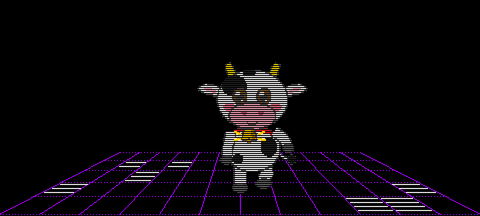
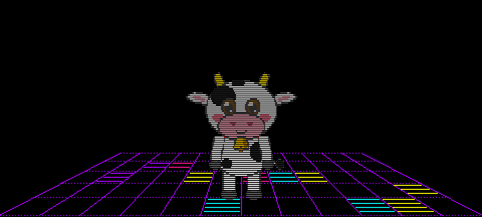

# BELLA (vu_bella.pack)

*Part of [field-packs](../../README.md), a look pack of [vu](../vu/README.md) 24. From the repository's root:
`OPEN_FIELD=<open-field> make vu_bella`; its host test is vu's (`bash tools/test_pack.sh vu`).*

Needs **vu.pack 24 or later** on the unit: the look registers with it at the first frame, and vu paints it on the mixer's
levels page, steps to it with a tap of the mixer key and turns TE's EQ with the knobs on it. Without vu 24 the pack does
nothing (an older vu does not know it).

| Where | What | Does |
| --- | --- | --- |
| settings | none of its own (since vu 25) | in vu's round while installed |

## The look

**An optional look:** install it if you like it; the core looks are SUNDOWN, SPECTRUM, CLASSIC, LCD and VU.

**vu_bella 2** was vu_mary 1: MARY BELLE's own look is dropped ("bella > mary belle"); her sprites and her dance stay,
as BELLA's. Delete `vu_mary.pack` from the unit when you put this one on: both together, BELLA comes from vu_bella
(it sorts first, vu refuses the second BELLA) and vu_mary still adds MARY BELLE.

- **BELLA** (redrawn in vu 24, trimmed in vu_bella 3): MARY BELLE as a 90s car stereo's LED panel, everything in LED
  rows with 1 px scanline gaps and black left unpainted.
  - **Her**: centre stage, MARY BELLE's own dance at 3/4 size, in cow colours: a white body with near-black spots, a
    pink snout, yellow horns, a red collar with a gold bell, dark eyes, a mid-grey outline so her shape reads at 1x.
    Every other row lit (a word store each).
  - **The floor**: a neon outline grid in perspective under her feet (5 rows of 12 tiles from row 152, the full width at the front,
    dotted LED lines). A tile lights in every column across the whole floor: each column is two bands, bass on the left
    and highs on the right (tilted up a little, as a mix falls off), lit at the depth of its level (quiet: the front
    row, loud: the back), every other LED row filled; white on a kick. At most 12 a frame, one a column.
  - vu_bella 3: the scope and the radar are gone ("just too much"), the floor is an outline grid, not filled tiles.
  - vu_bella 4: her sprites are baked at 3/4 by `mary_sprites.py` (a value a word: the even row lit), not scaled on
    the unit; nothing is painted until the base's blank page is up (no clear of TE's frame first); the lit tiles
    spread over the whole floor ("why only half bella floor light up").
  - vu_bella 5: the spectrum strip on top is gone ("the floor lights up based on freq"), the floor starts higher
    (row 152), the MOO bubble is a white outline with white words (no white fill).
  - vu_bella 6: the MOO bubble is straight LED edges (dotted top and bottom, solid sides), a 1 px tail and words at
    2 x 3, painted directly (no rounded box drawn a pixel at a time). Every 10 s while she is shown the log says
    `vu_bella: dearest paint N cycles, M ms after the look came up, K frames on the blank page, MOO, hop, kick`: her own
    paint's dearest frame and what it held, beside vu's `vu looks` line (whose "most" counts the whole frame).
  - vu_bella 9 (vu 32): that line is logged from her pack's frame function, outside vu's timed span; her hint is
    `BELLA_HINT` (628) for both her looks (vu_bella 8 changed only `look_bella.h`'s; the pack registers its own, at 815).
  - Colour is decoration only: peaks are lone segments, lit tiles filled, the rest outlines.
  - Cost, measured on the unit: vu_bella 2 2.28 M cycles a frame on average; vu_bella 3 1.29 M (12.8 M at most);
    vu_bella 4 0.93 M average, 1.68 M at most; vu_bella 5 0.80 M average, 3.57 M at most (a window from a fresh boot,
    opening the mixer, the first MOO). On the model (which matched the averages): vu_bella 6 ~0.82 M average, 1.06 M
    worst, every frame of the test loop logged by state: the dearest are MOO frames, none over 1.07 M. The 3.57 M frame
    is not reproduced on the Mac; the new log line says whether it is in her paint at all.

   (1x: pictures/bella_1x.png, moving: pictures/bella.gif)

## The luchadora (vu_bella 10, with vu 33 and punch)

While one of punch's effects is held, Bella is a luchadora: her head masked (one sprite with the mask, its pattern by
the effect's family: stripes for filters, a star for time and space, diamonds for repeats, flames for destruction), a
cape fluttering on the beat (its middle left out, it is behind her), her tail under it. The dance floor's lines take the
family's colour and flash white on every beat (every sixteenth for repeats); its tiles rest. Nothing is painted under
vu's strip of held effects. Cost with an effect held stays under hers without (see vu's CHANGELOG).

