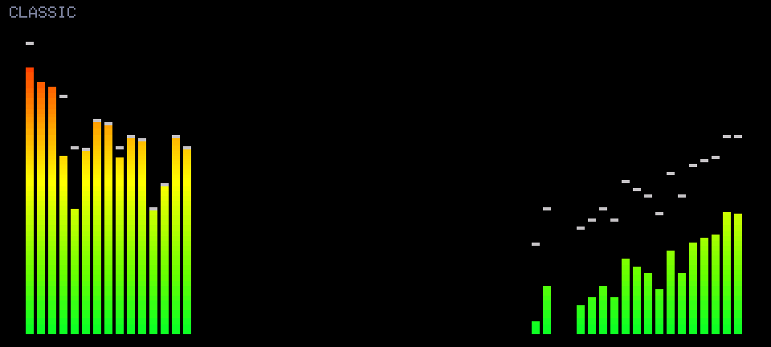

# CLASSIC (vu_classic.pack)

*Part of [field-packs](../../README.md), a look pack of [vu](../vu/README.md) 24. From the repository's root:
`OPEN_FIELD=<open-field> make vu_classic`; its host test is vu's (`bash tools/test_pack.sh vu`).*

Needs **vu.pack 24 or later** on the unit: the look registers with it at the first frame, and vu paints it on the mixer's
levels page, steps to it with a tap of the mixer key and turns TE's EQ with the knobs on it. Without vu 24 the pack does
nothing (an older vu does not know it).

| Where | What | Does |
| --- | --- | --- |
| settings > packs > vu | **classic** bars / dots / lines | CLASSIC as the analyser, or the mix's wave in dots or lines (bars at first; vu 25+, vu_classic 2: no entry of its own). An option of words: it shows on bases with option words (the vu 34 release's vu.pack carries it); on other bases, open-field 0.24 (base 42) and older among them, the row doesn't show and CLASSIC draws bars |

## The look

**A core look.**

- **CLASSIC**: the old desktop players' analyser, in our own drawing. 64 thin bars on black, coloured by row: green at
  the bottom, yellow, then red at the top. Each bar has a 2 px peak cap that falls. With vu's **classic** set to
  dots or lines, it is the mix's wave instead, in the same gradient.

