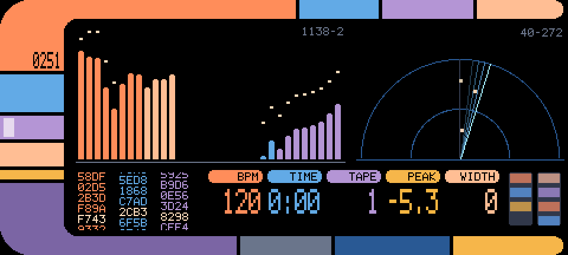
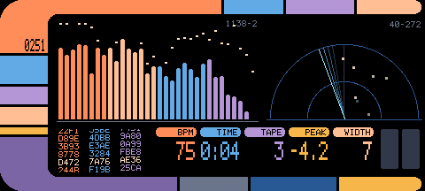

# CONSOLE (vu_console.pack)

*Part of [field-packs](../../README.md), a look pack of [vu](../vu/README.md) 24. From the repository's root:
`OPEN_FIELD=<open-field> make vu_console`; its host test is vu's (`bash tools/test_pack.sh vu`).*

Needs **vu.pack 24 or later** on the unit: the look registers with it at the first frame, and vu paints it on the mixer's
levels page, steps to it with a tap of the mixer key and turns TE's EQ with the knobs on it. Without vu 24 the pack does
nothing (an older vu does not know it).

| Where | What | Does |
| --- | --- | --- |
| settings | none of its own (since vu 25) | in vu's round while installed |

## The look

**An optional look:** install it if you like it; the core looks are SUNDOWN, SPECTRUM, CLASSIC, LCD and VU.

On the unit (2026-11-25):

- **CONSOLE**: a retro sci-fi computer panel, the kind of flat, colourful control screen science-fiction sets put on the
  walls: a rounded elbow frame, colour blocks and pill-shaped bars. It is our own drawing: no names, logos or art of
  anyone's, and the panel codes are made-up numbers.
  - **Frame**: rounded elbows, pill bars and blocky condensed printing in a peach, blue, lilac and gold family.
  - **Spectrum**: the 32 bands as pill bars with cream caps at the held peaks.
  - **Sweep**: a half-disc scanner that swings back and forth. Kicks leave blips near the centre, hi-hats far out, and the
    blips fade.
  - **Scrolling numbers**: three columns of hex that scroll faster with the energy.
  - **Readouts** that tick 4 times a second: BPM, tape time, tape, peak dBFS, stereo width (%).
  - **Lamps**: blocks that light on the beats, and a chase down the left column.

