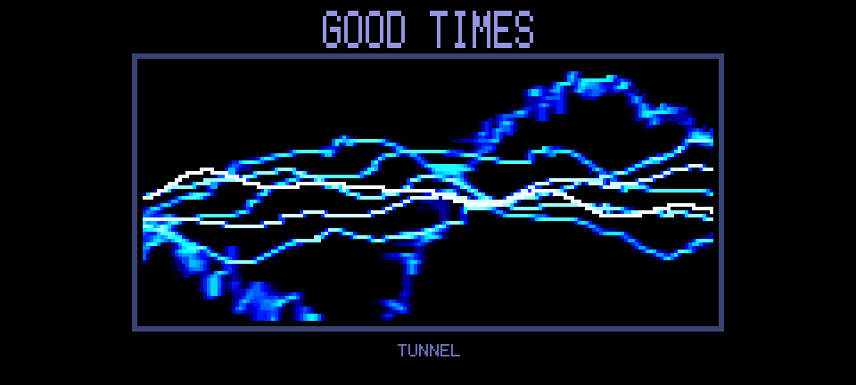

# GOOD TIMES (vu_goodtimes.pack)

*Part of [field-packs](../../README.md), a look pack of [vu](../vu/README.md) 24. From the repository's root:
`OPEN_FIELD=<open-field> make vu_goodtimes`; its host test is vu's (`bash tools/test_pack.sh vu`).*

Needs **vu.pack 24 or later** on the unit: the look registers with it at the first frame, and vu paints it on the mixer's
levels page, steps to it with a tap of the mixer key and turns TE's EQ with the knobs on it. Without vu 24 the pack does
nothing (an older vu does not know it).

| Where | What | Does |
| --- | --- | --- |
| settings | none of its own (since vu 25) | in vu's round while installed |

## The look

**An optional look:** install it if you like it; the core looks are SUNDOWN, SPECTRUM, CLASSIC, LCD and VU.

- **GOOD TIMES**: a feedback picture at 160 × 72, shown at 3×. Every frame the last one is zoomed, turned and rippled through
  a mesh of 21 × 10 points, blurred a little and faded, then the wave or the bars are drawn into it. A bass beat kicks
  the zoom and the turn, and swaps the colours. The preset changes every 16 s:
  - tunnel: the wave across, blue and cyan.
  - swirl: the wave in a ring, magenta and orange.
  - ripple: the bars, green and yellow.
  - bloom: the wave upright, a ring on each beat, red and violet.

