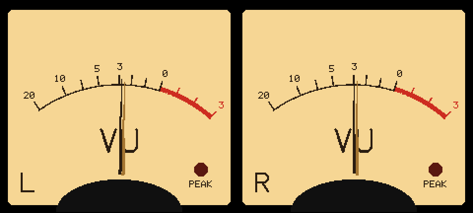

# VU meters (vu_meter.pack)

*Part of [field-packs](../../README.md), a look pack of [vu](../vu/README.md) 24. From the repository's root:
`OPEN_FIELD=<open-field> make vu_meter`; its host test is vu's (`bash tools/test_pack.sh vu`).*

Needs **vu.pack 24 or later** on the unit: the look registers with it at the first frame, and vu paints it on the mixer's
levels page, steps to it with a tap of the mixer key and turns TE's EQ with the knobs on it. Without vu 24 the pack does
nothing (an older vu does not know it).

| Where | What | Does |
| --- | --- | --- |
| settings | none of its own (since vu 25) | in vu's round while installed |

## The look

**A core look.**

- **VU**: a pair of analogue meters for L and R.
  - **Face**: warm, backlit cream and amber, behind bevelled bezels with a glass sheen.
  - **Scale**: an amplitude-linear arc from 20 to 3 VU, unsigned as on old meters: black under 0, red over it. It has
    fine and major ticks, a red band from 0 to 3, a percent scale under it and the printed VU legend.
  - **Needle**: tapered with a shadow, coming out of a dark dome. It moves like a real meter: damped, reaching its place
    in about 300 ms with a touch of overshoot. 0 VU is a sine at -14 dBFS.
  - **PEAK**: a real little lamp that lights with a glow ring and a hot core at -1 dBFS. The word is printed under it.
- The still parts (face, scale, bezel) come from vu's `meter_art.h` (made by `meter_art.py`); only the needles and lamps are drawn on the unit.

