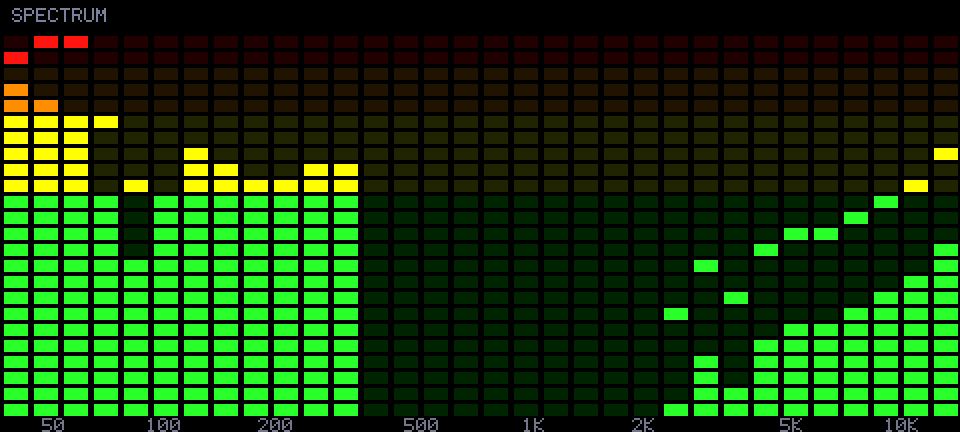

# SPECTRUM (vu_spectrum.pack)

*Part of [field-packs](../../README.md), a look pack of [vu](../vu/README.md) 24. From the repository's root:
`OPEN_FIELD=<open-field> make vu_spectrum`; its host test is vu's (`bash tools/test_pack.sh vu`).*

Needs **vu.pack 24 or later** on the unit: the look registers with it at the first frame, and vu paints it on the mixer's
levels page, steps to it with a tap of the mixer key and turns TE's EQ with the knobs on it. Without vu 24 the pack does
nothing (an older vu does not know it).

**vu_spectrum 6: SPECTRUM only.** SUNDOWN, which vu_spectrum 2-5 carried too, is its own pack now:
[vu_sundown](../vu_sundown/README.md). Install both to keep both.

| Where | What | Does |
| --- | --- | --- |
| settings | none of its own (since vu 25) | SPECTRUM in vu's round while installed |

## The look

**A core look.**

- **SPECTRUM**: 32 bands, 40 Hz to 16 kHz, 24 segments of 2.5 dB each. Green at the bottom, then yellow, orange and
  red. Unlit segments stay dim. A peak segment holds for 0.7 s and then falls.

