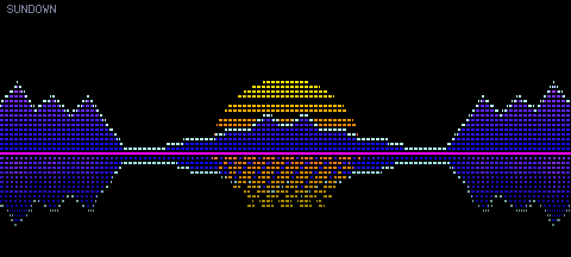
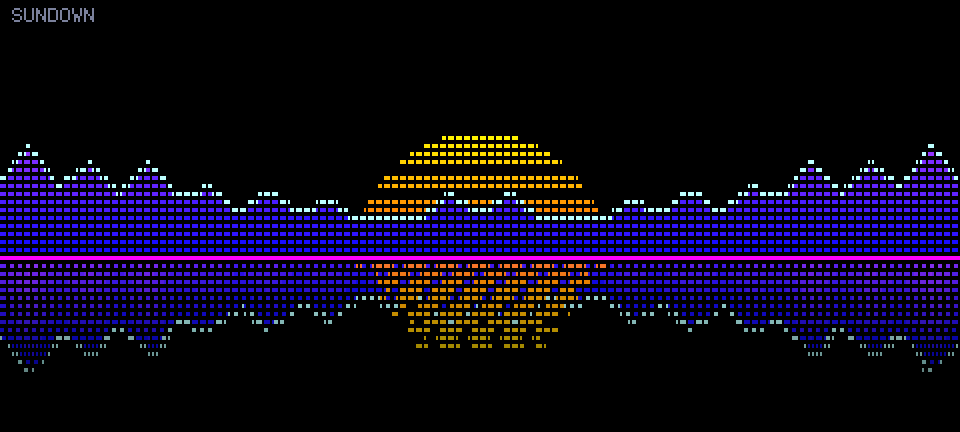

# SUNDOWN (vu_sundown.pack)

*Part of [field-packs](../../README.md), a look pack of [vu](../vu/README.md) 24. From the repository's root:
`OPEN_FIELD=<open-field> make vu_sundown`; its host test is vu's (`bash tools/test_pack.sh vu`).*

Needs **vu.pack 24 or later** on the unit: the look registers with it at the first frame, and vu paints it on the mixer's
levels page, steps to it with a tap of the mixer key and turns TE's EQ with the knobs on it. Without vu 24 the pack does
nothing (an older vu does not know it).

**vu_sundown 1:** SUNDOWN was in vu_spectrum 2-5; it is its own pack now, the same code and the same look number, so a
unit whose kept look (`user/pf/vu/look.txt`) is SUNDOWN keeps it once vu_sundown is installed.

| Where | What | Does |
| --- | --- | --- |
| settings | none of its own | SUNDOWN in vu's round while installed |

## The look

**A core look.**

- **SUNDOWN** (vu 23): a synthwave sunset in LED segments. A striped sun sets on a neon horizon behind mountains made
  of the bands: 8 peaks a side, mirrored, the lows at the edges and the highs by the sun, each peak as high as the
  loudest of its 4 bands, a pale ridge on top. A kick swells the sun a little.
- **The water** (vu_spectrum 2): under the horizon the bands come alive too. The mountains mirrored downward, as tall as
  above, bright by the horizon and fading with depth, in LED rows 2 on 2 off, each row shifted a pixel or two on a
  ripple that runs with time (wider on a kick). The sun's reflection is broken stripes narrowing downward, 4 to ~19
  rows long with the lows' level. ~0.32 M average / 0.55 M worst on the calibrated model.
- **Punch** (vu_spectrum 5, with vu 33+): sun and mountains take the held effect's colours; destruction brings lightning
  onto the two highest peaks.

  

