# fx wagons (wagons.pack)

*Part of [field-packs](../../README.md): this folder is hasis/fx-wagons, brought in with its history. From the
repository's root: `OPEN_FIELD=<open-field> make wagons` (or `make check` for every pack); inside this folder its own
`make pack` / `make check` work as before. The built file: [`dist/wagons.pack`](../wagons.pack).*

Part of the **fx 1** release (wagons 13). Five effects for the OP-1 Field, in one pack for [open-field](https://github.com/LaP0573/open-field) 0.12 (OS 1.7.3):
**BOOST, GATE, FREEZE, TAPE and JUNEAUX**. Each one joins the unit's own effect lists (T3) for every synth sound, drum
sound and the master, is saved with the sound, can be moved by the LFOs, and shows a faceplate of its own that moves
with the sound.

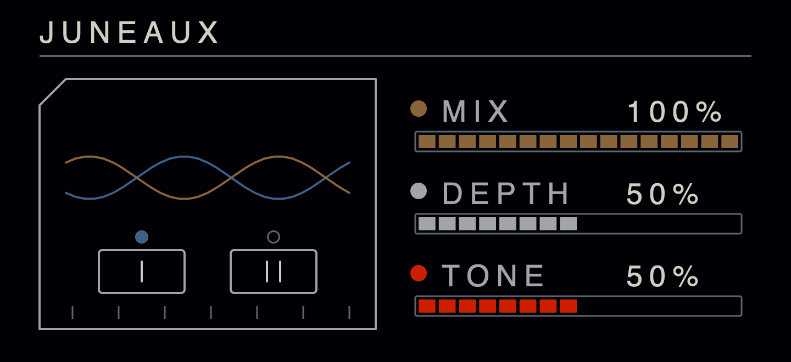

## Screenshots

Renders from the packs' own pictures (`python3 -I src/face.py preview`, `src/wagon_art.py preview`; the texts in a stand-in font), also in [`pictures/`](pictures).

| | |
|---|---|
| 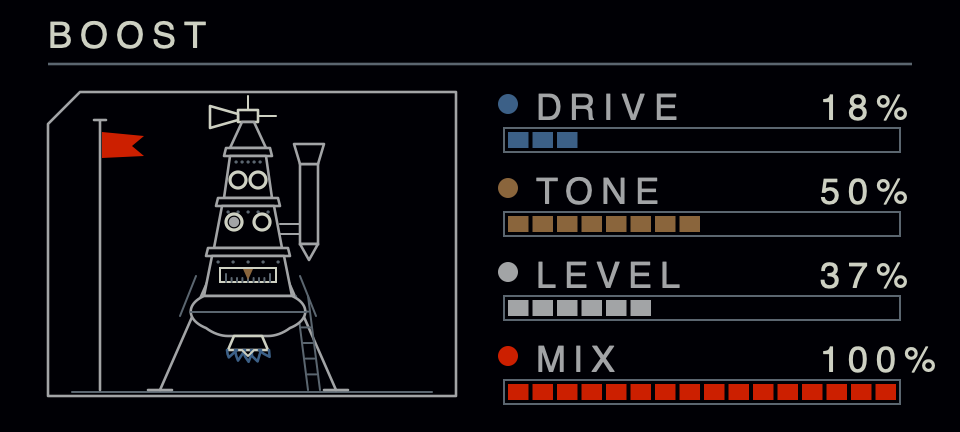 | 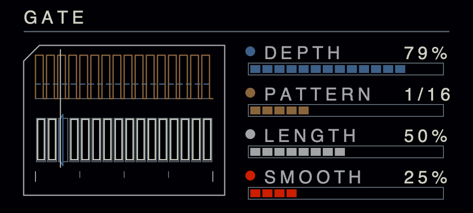 |
| **BOOST** (render) | **GATE** (render) |
| 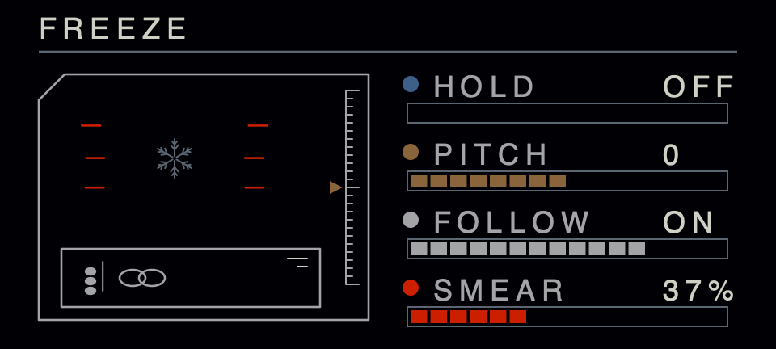 | 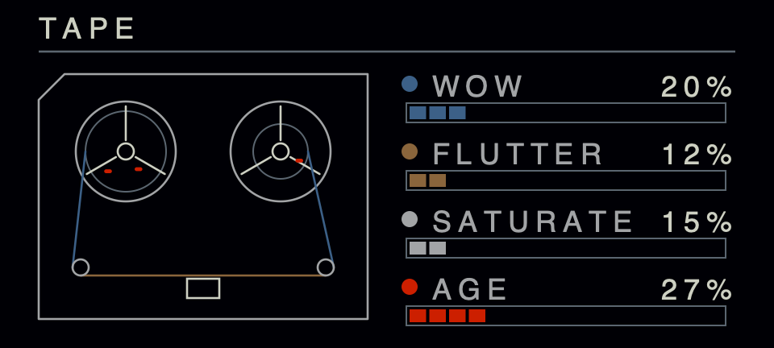 |
| **FREEZE** (render) | **TAPE** (render) |
| 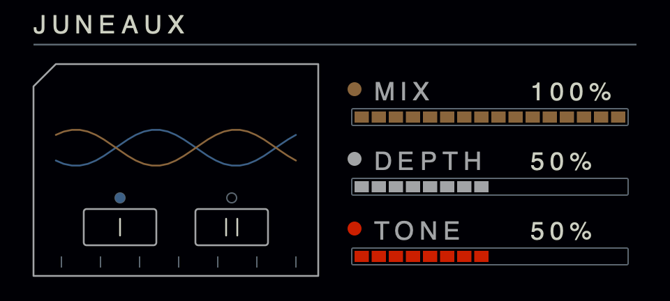 | 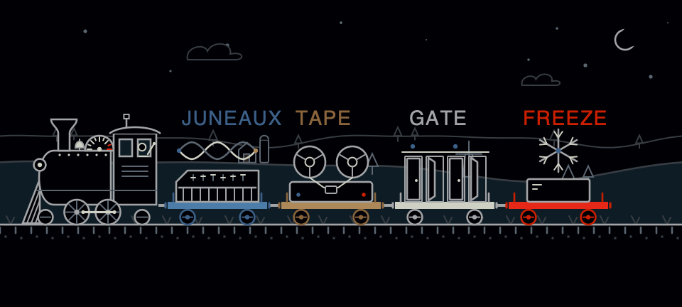 |
| **JUNEAUX** (render) | **On fx train 18+** (render): JUNEAUX, TAPE, GATE, FREEZE as wagons. |

## The effects

Knobs are named by position, 1st to 4th encoder from the left. Values in words are what the page shows; the others
are 0 to 100 %.

| Effect | Rides on | 1st | 2nd | 3rd | 4th |
| --- | --- | --- | --- | --- | --- |
| **BOOST** | punch | DRIVE | TONE | LEVEL | MIX |
| **GATE** | nitro | DEPTH | PATTERN | LENGTH | SMOOTH |
| **FREEZE** | grid | HOLD | PITCH | FOLLOW | SMEAR |
| **TAPE** | phone | WOW | FLUTTER | SATURATE | AGE |
| **JUNEAUX** | cwo | MODE | MIX | DEPTH | TONE |

"Rides on" is the unit's own effect each one stands in for: a sound saved with a wagons effect plays that effect, dry,
on a unit without the pack.

- **BOOST**, a booster pedal (`src/fx_boost.h`). DRIVE: gain into a soft clip, x1 to x50 (0 to +34 dB, the low half of
  the knob is the fine part), with a little asymmetry that grows with it. TONE: a tilt after the clip, 0 dark (about
  2 kHz lowpass), 50 % flat, 100 % highs +6 dB. LEVEL: output x0.25 to x4 (-12 to +12 dB), rounding off at full scale.
  MIX: dry to wet. Default: a push of about +9 dB with a little hair, good for engines that sit quiet.
- **GATE**, a gate locked to the bar (`src/fx_special.cpp`). DEPTH: how far it shuts. PATTERN: `1/4`, `1/8`, `1/16`,
  `1/8t`, `stab`, `chrl`, `sync`, `trnc`. LENGTH: each opening, 10 to 100 % of the gap to the next hit. SMOOTH: the
  edges, about 0.2 ms to 12 ms. It reads the unit's own tempo and beat counter, so its pattern starts on the bar and
  follows tempo changes.
- **FREEZE**, holds a moment as a pad (`src/fx_special.cpp`). HOLD: up from 0 catches what is playing and holds it
  (grains over the frozen buffer), the wetter the higher; at 0 (`off`) it lets go. PITCH: -12 to +12 semitones. FOLLOW:
  `on` moves the held pad with CHERD's chord root, `off` keeps it. SMEAR: shorter grains, about 180 ms down to 34 ms,
  grainier and more blurred.
- **TAPE**, a worn tape machine for mellotron-ish keys and pads (`src/fx_tape_wagon.h`). WOW: slow pitch sway. FLUTTER:
  fast pitch tremble. SATURATE: drive x1 to x1.75 into a rounded, level-matched curve (warmth and compression, never
  fuzz). AGE: the top rolls off to about 3 kHz, hiss up to about -54 dBFS, and over its upper half short dropouts.
- **JUNEAUX**, the Juno-60 chorus (`src/fx_juno.h`). MODE: `i` (0.513 Hz), `ii` (0.863 Hz), `i+ii` (9.75 Hz, mono), shown
  as the lights over the buttons I and II. MIX: up to the original's balance. DEPTH: x0 to x2 around the mode's sweep.
  TONE: the low-pass after the line, about 7.5 kHz at the centre.

### Faceplates

Open an effect's page as any T3 page; leave it with T3. Each knob's part of the drawing is in that knob's colour and
named in words, so nothing hangs on telling colours apart. TAPE's reels turn, GATE's doors swing under a playhead in
time with the tempo, FREEZE's flake grows with HOLD, BOOST's rocket lights its exhaust with DRIVE.

| | |
| --- | --- |
| 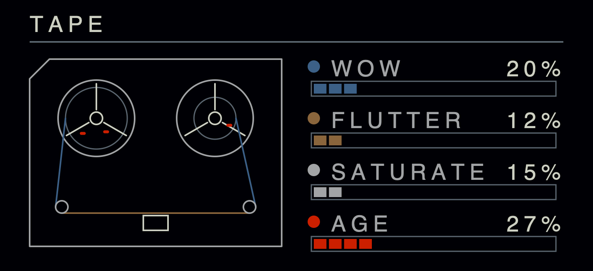 | 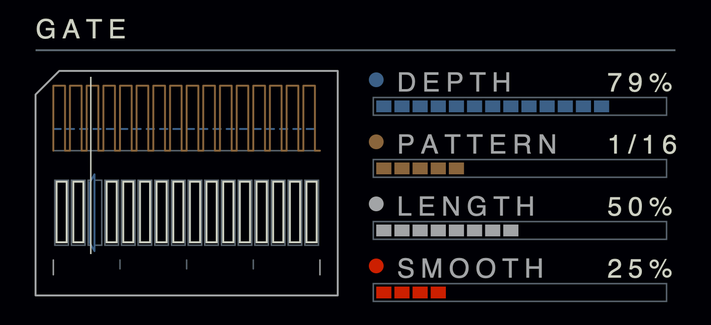 |
| 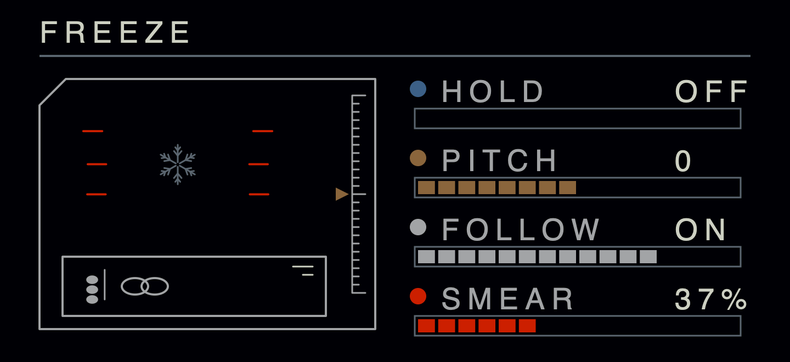 | 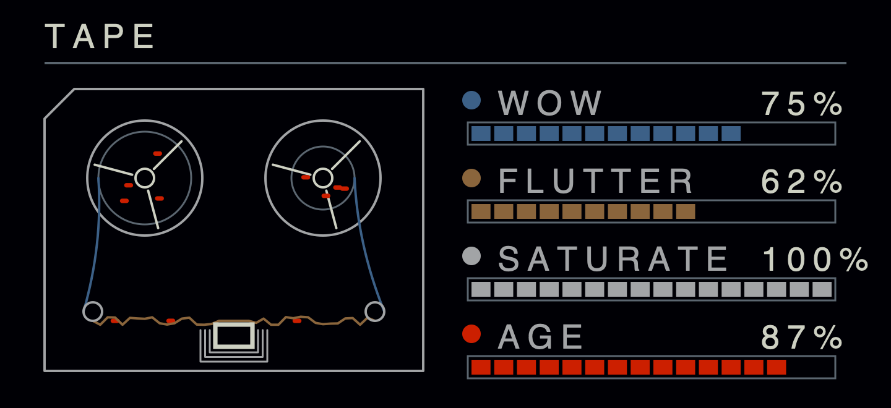 |

The pictures are drawn on a Mac from the same picture files the unit draws (`python3 -I src/face.py preview`).

### On fx train

With fx train 18 or later (proposed to open-field, not in Faust's release yet) each effect carries its own wagon picture on the train
(`pack/wagon_px.h`, drawn from `src/wagon_art.h`). With Faust's fx train 17 (stock), or a pack built with the stock tools,
the train draws the TE effect each one rides. The sound is the same either way. On **snowtrain** (fx 1) they are cars
by name.

## Install

1. open-field 0.12 on the unit (its install page puts on the loader and `base.pack`).
2. Copy `wagons.pack` (from the fx 1 release zip, or built) into the folder `packs` the unit shows in disk mode
   (`user/pk` on its disk), or tick it on open-field's install page once it is listed there.
3. Leave disk mode and switch the unit off and on. The five effects are in T3's lists.

Holding the help key while switching on starts the unit with no packs. Delete the file to remove the effects.

### Needs

- An OP-1 Field on **OS 1.7.3** (the +0 and +1 releases both work) with open-field 0.12: `base.pack` level 10
  (base 30 or later). Nothing else.
- Optional: [CHERD](../cherd) (`cherd.pack`). When it is on the unit, FREEZE's FOLLOW moves with
  its chord; without it FREEZE holds its pitch.

